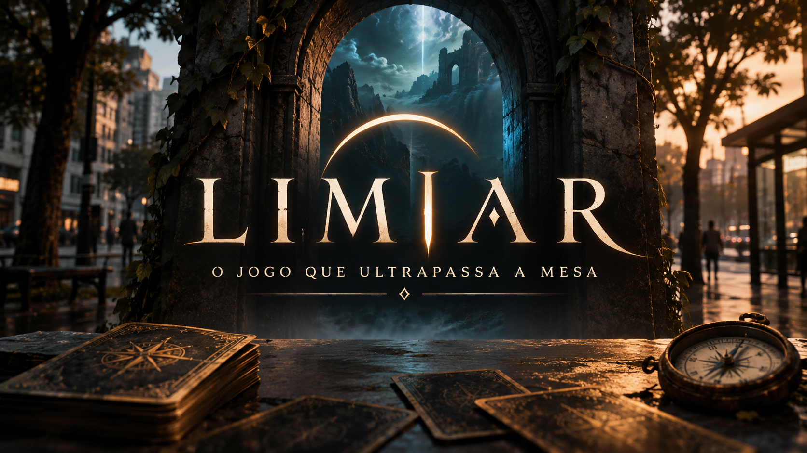

# LIMIAR — Manual de Jogo, Regras e Oráculos

> **Edição revisada 1.1 · 3 universos · 162 cartas de referência**  
> **Slogan:** *"O Jogo que Ultrapassa a Mesa — O jogo que acontece na sua realidade."*

**Limiar** é um RPG de cartas na vida real (*pervasive tabletop card game*) feito para ser jogado misturado à sua rotina diária — durante um passeio, em casa ou à distância por mensagens e áudios — usando qualquer baralho de **54 cartas** (52 tradicionais + 2 Coringas) ou cartas impressas no tamanho padrão de Magic/Poker (**63mm × 88mm**).

Este manual reúne as regras-base, exemplos de partida e três universos narrativos. Cada universo contém 54 cartas de referência: 12 cartas do **Trio de Bolso** e 42 cartas do **Deck do Mundo**. As regras desta edição foram organizadas para reduzir ambiguidades, facilitar o primeiro jogo e proteger a rotina e a segurança dos participantes. As cartas dos três universos foram preservadas como conteúdo criativo; seus comandos devem ser interpretados à luz das regras gerais de segurança e resolução.

---

# Parte 1: Manual de Regras & Como Começar a Jogar

## 1.1. O que você precisa para jogar

**Limiar** pode ser jogado em três formatos:

1. **Baralho comum:** um baralho de 54 cartas (52 cartas tradicionais e 2 coringas). Use as tabelas deste manual para consultar os efeitos.
2. **Cartas impressas:** cartas no tamanho padrão de pôquer (`63 × 88 mm`), com frente temática e identificação clara do naipe e valor.
3. **Digital:** uma versão web ou aplicativo, quando disponível. O aplicativo é opcional; as regras não dependem dele.

Para uma partida em dupla à distância, cada participante precisa de um baralho próprio, com as mesmas 42 cartas do Deck do Mundo e na mesma ordem inicial. As 12 figuras ficam separadas para formar os Trios de Bolso.

---

## 1.2. Preparação: seu Trio de Bolso

Retire do baralho as 12 figuras: os quatro Reis (`K`), as quatro Damas (`Q`) e os quatro Valetes (`J`). Cada jogador escolhe um naipe que representa sua vocação e recebe as três figuras desse naipe. Esse conjunto é seu **Trio de Bolso**.

- **👑 Rei (`K`) — identidade:** fica aberto durante toda a campanha. Representa a vocação do personagem, oferece uma pequena interpretação temática para a rotina e concede a sinergia descrita na carta.
- **🛡️ Dama (`Q`) — proteção:** começa aberta e pronta. Pode ser virada 90° (`⟳`) para ativar seu poder ou evitar uma consequência, conforme as regras gerais e o texto da carta. Uma Dama deitada está esgotada.
- **🩸 Valete (`J`) — cicatriz:** começa fechado, com a face para baixo. Quando é revelado, representa uma complicação persistente e ativa o tabu descrito na carta. O Valete revelado permanece ativo até ser curado por um efeito.

> **Importante:** as atitudes de rotina sugeridas pelo Rei são **convites narrativos, não obrigações**. Não precisam ser realizadas se forem inconvenientes, inseguras ou inadequadas ao contexto.

### 1.2.1. Como funciona a Dama (`Q`)

A Dama é um recurso individual e limitado:

1. Para ativá-la, gire-a 90° (`⟳`) e aplique o efeito descrito na própria carta.
2. Se uma carta permitir gastar a Dama para evitar uma consequência, o jogador decide se aceita a consequência ou usa a proteção.
3. Uma Dama deitada não pode ser ativada novamente até ser recarregada.
4. Como regra-base, cumprir com sucesso uma carta de **Ouros (`♦`, de Ás a 10)** recarrega a Dama do jogador que realizou a ação. Efeitos específicos podem recarregar outras Damas, se disserem isso expressamente.
5. O Rei de Ouros (`K♦`) pode ter uma recarga automática como habilidade própria. Essa habilidade é aplicada apenas ao seu portador e não substitui a regra de recarga dos demais.

A Dama não transforma automaticamente qualquer tentativa em vitória. Ela só produz o efeito descrito na sua carta ou na regra que autorizou seu uso.

### 1.2.2. Como funciona o Valete (`J`)

O Valete é revelado quando o jogador sofre uma falha grave sem ter uma Dama pronta para absorver a consequência, ou quando um efeito de carta determina sua revelação.

Quando o Valete fica aberto:
- aplique o tabu escrito na carta, **somente dentro das interações do jogo**;
- mantenha o Valete aberto até que uma carta ou habilidade o cure;
- **não transforme o tabu em uma obrigação fora do jogo**, nem em algo que impeça comunicação urgente, trabalho, direção, cuidado de crianças ou qualquer necessidade real.

Quebrar um tabu não é uma falha de caráter nem gera punição na vida real. Para fins de jogo, o grupo pode simplesmente considerar o tabu encerrado e manter o Valete aberto até que seja curado por uma regra.

### 1.2.3. Colapso

Um personagem entra em **Colapso** quando uma nova falha exigiria revelar ou agravar um Valete já ativo e sua Dama está esgotada.

Em uma partida cooperativa, o parceiro pode evitar o Colapso gastando a própria Dama pronta, desde que a carta dele permita esse tipo de proteção. Se não puder ou não quiser fazê-lo, a campanha termina em derrota narrativa. O grupo pode então escrever um epílogo ou iniciar uma nova campanha.

O Colapso não representa dano, risco ou obrigação na vida real. É apenas um estado ficcional.

---

## 1.3. O Deck do Mundo: 42 cartas

O Deck do Mundo contém:
- **40 cartas numeradas:** Ás a 10 de cada um dos quatro naipes (`♠, ♥, ♦, ♣`);
- **1 Coringa Claro (`★`)**;
- **1 Coringa Escuro (`💀`)**.

As 12 figuras do Trio de Bolso não entram nesse deck.

### Partida presencial
Embaralhem as 42 cartas e coloquem o baralho no centro. Um único baralho é suficiente.

### Partida à distância: Cifra do Dia
A Cifra do Dia permite que dois baralhos independentes comecem na mesma ordem, sem aplicativo ou chamada de vídeo. Os dois participantes devem usar a mesma data local e executar os passos exatamente da mesma maneira.

- **Ordem-base:** organizem as cartas nesta sequência: Ás a 10 de Espadas (`♠`), Ás a 10 de Copas (`♥`), Ás a 10 de Ouros (`♦`), Ás a 10 de Paus (`♣`), Coringa Claro (`★`) e Coringa Escuro (`💀`).
- **Corte do dia:**
  1. Separem do topo um bloco com a quantidade de cartas igual ao dia do mês.
  2. Coloquem esse bloco inteiro no fundo, sem inverter sua ordem.
  3. Distribuam as cartas restantes, uma por vez, em três montes: Esquerda, Centro e Direita, repetindo sempre essa sequência.
  4. Ao distribuir, cada carta nova deve ser colocada sobre o monte correspondente.
  5. Reúnam os montes nesta ordem: coloquem o monte Centro sobre o monte Esquerda; depois coloquem esse conjunto sobre o monte Direita.
- **Corte do mês:**
  1. Separem do topo um bloco com a quantidade de cartas igual ao número do mês.
  2. Coloquem esse bloco inteiro no fundo, sem inverter sua ordem.
  3. Distribuam as cartas, uma por vez, alternando entre dois montes: Esquerda e Direita.
  4. Coloquem o monte Esquerda sobre o monte Direita.

Os dois participantes devem manter a orientação do baralho e a ordem de recolhimento idênticas. Não embaralhem depois da Cifra do Dia.

*Exemplo:* em 7 de novembro, o corte do dia usa 7 cartas e o corte do mês usa 11 cartas.

> **Nota importante:** A Cifra do Dia sincroniza a ordem inicial. Ela não significa que os dois jogadores terão o mesmo estado de baralho depois de começarem a retirar cartas: cada um retira cartas de uma extremidade diferente, conforme a sequência de turnos.

---

## 1.4. Como funciona uma rodada: Vigia e Eco

Em dupla, cada rodada combina duas cartas diferentes para criar uma cena e uma resposta.

### Primeiro papel: Vigia (`☀ Topo`)
1. O Vigia retira a carta disponível no topo do próprio baralho.
2. Lê somente a coluna **☀ Se tirar do topo**.
3. Aguarda o gatilho indicado. Quando ele acontecer, ou quando usar um gatilho substituto permitido, envia ao parceiro uma mensagem curta narrando o evento ficcional.
4. O Vigia não revela nem consulta a carta que está no fundo.

### Segundo papel: Eco (`☾ Fundo`)
1. Depois de receber a cena, o Eco retira a carta disponível no fundo do próprio baralho.
2. Lê somente a coluna **☾ Se tirar do fundo**.
3. Aplica a ação sugerida à cena narrada pelo Vigia.
4. Os jogadores resolvem o resultado usando a regra da carta e seus Trios de Bolso.

### Alternância
Na rodada seguinte, os papéis se invertem:
- quem foi Vigia passa a retirar do fundo e será Eco;
- quem foi Eco passa a retirar do topo e será Vigia.

Cada jogador usa seu próprio baralho sincronizado. Não se deve retirar duas cartas do mesmo baralho compartilhado em uma partida remota.

### Prazo dos gatilhos
Para evitar que a campanha fique parada:
- o gatilho original pode ser aguardado por **até 2 horas** a partir do momento em que a carta foi comprada;
- se não acontecer, o Vigia pode escolher um **gatilho substituto simples e seguro** relacionado ao tema da carta;
- se não houver um substituto adequado, a carta é considerada **adiada**: não há penalidade, e a rodada pode ser retomada mais tarde;
- nenhum jogador precisa interromper uma atividade, criar uma situação artificial ou correr riscos para ativar um gatilho.

O grupo pode escolher antes da campanha um ritmo mais lento, como uma rodada por manhã e outra à noite. O importante é combinar o ritmo e mantê-lo.

---

## 1.5. Resolução de uma cena: ordem de prioridade

Quando a ação do Eco for concluída, resolvam os efeitos nesta ordem:

1. **Segurança e limites reais:** qualquer jogador pode adaptar, substituir ou ignorar uma ação que seja insegura, invasiva ou inconveniente, sem penalidade.
2. **Ação do Eco:** o jogador declara o que seu personagem tenta fazer.
3. **Efeito específico da carta:** leiam o desfecho indicado na carta do Eco. Se houver uma condição, verifiquem se ela foi cumprida.
4. **Sinergia do Rei:** aplique a habilidade do Rei do jogador envolvido, se a condição de naipe for atendida.
5. **Dama:** o jogador pode ativar uma Dama pronta se o texto da carta ou a regra permitir.
6. **Consequência:** se a condição não foi cumprida e nenhuma proteção foi usada, aplique a falha indicada.
7. **Valete e Colapso:** revele o Valete ou verifique o Colapso, quando aplicável.

> **Regra de desempate:** o texto específico da carta prevalece sobre a regra geral somente quando disser claramente que substitui, cancela ou modifica aquela regra. Na ausência dessa indicação, vale a ordem de prioridade acima. Um efeito nunca pode obrigar alguém a fazer algo inseguro na vida real.

### Sucesso, falha e custo
- **Sucesso:** a ação narrativa atende à condição da carta. Aplique o benefício indicado.
- **Sucesso com custo:** a ação funciona, mas o jogador precisa gastar uma Dama ou aceitar outra consequência descrita.
- **Falha:** a condição não é atendida. Se houver Dama pronta e a regra permitir, o jogador pode gastá-la para evitar a consequência. Caso contrário, aplique o efeito de falha e verifique o Valete.
- **Escolha narrativa:** quando uma carta apresenta duas opções, o jogador escolhe uma delas. Não é necessário executar uma ação física; uma decisão narrada ou mensagem pode resolver a cena.

---

## 1.6. Exemplo de partida em dupla

Imagine uma partida de *Zona de Quarentena*:
- **Jogador A** tem o Rei de Paus (`K♣`) e está no papel de **Vigia**.
- **Jogador B** tem o Rei de Espadas (`K♠`) e está no papel de **Eco**.
- O Vigia compra `6♣` e lê o texto do topo.
- Ao tocar normalmente numa maçaneta durante o dia, o gatilho acontece. Não é necessário procurar uma porta especial nem fotografar o local.
- O Vigia manda: *"A marca de uma mão ensanguentada apareceu na porta do abrigo. Os fanáticos descobriram onde estamos."*
- O Eco compra `7♠` do fundo e lê a reação.
- A carta pede que ele escolha entre confronto narrativo ou recuo estratégico.
- O Eco escolhe recuar e explica como o personagem protege a dupla.
- O efeito específico da carta é aplicado. Se houver condição de naipe, o Rei de Espadas pode ativar sua sinergia. Se a carta exigir custo, o Eco decide se gasta sua Dama pronta.
- A cena termina e, na próxima rodada, os papéis se invertem.

A ação ocorre na ficção. Nenhum jogador precisa abrir portas desconhecidas, confrontar pessoas, procurar locais perigosos ou sair do caminho.

---

## 1.7. Modo solo

No modo solo, o jogador controla o protagonista e o narrador:

1. Retire uma carta do topo e leia apenas a coluna **☀ Topo**.
2. Aguarde o gatilho por até 2 horas ou escolha um substituto seguro.
3. Quando a cena for ativada, retire uma carta do fundo e leia a coluna **☾ Fundo**.
4. Responda à ação em voz, texto ou diário.
5. Resolva o efeito usando o Trio de Bolso.
6. Registre uma ou duas frases sobre o que aconteceu na campanha.

No modo solo, o jogador pode adaptar qualquer instrução originalmente dirigida ao parceiro para uma resposta no diário. Se uma ação não fizer sentido sozinho, substitua-a por uma escolha narrativa equivalente.

---

## 1.8. Regras de segurança, privacidade e acessibilidade

**Limiar deve caber na vida real, não colocar a vida real em risco.**

- Nunca jogue enquanto dirige, pedala, atravessa ruas, opera máquinas ou realiza uma tarefa que exija atenção.
- Não corra, suba em lugares, toque em objetos perigosos, mexa em instalações elétricas, abra portas desconhecidas ou se aproxime de pessoas/animais por causa de uma carta.
- Não fotografe nem grave terceiros sem consentimento. Não compartilhe endereço, localização em tempo real, placas, rostos ou informações privadas.
- Não faça desafios que envolvam prender a respiração, ingerir substâncias, consumir alimentos, gastar dinheiro ou alterar medicação.
- Não interrompa trabalho, estudo, sono, compromissos ou cuidados com outras pessoas.
- Qualquer jogador pode dizer **"pausa"** ou **"passo"** a qualquer momento. Isso não gera punição, perda de personagem ou discussão.
- **Toda ação física pode ser substituída por uma descrição, escolha ou mensagem.**
- Quando uma carta sugerir foto, áudio, toque, deslocamento, gesto ou uso de um objeto, isso é apenas um recurso opcional de ambientação. A versão padrão é narrar ou escrever o que o personagem faria. Nunca é necessário fotografar o ambiente real, tocar em algo, mover-se ou usar um objeto para validar uma jogada.
- Prazos curtos impressos em cartas (por exemplo, responder em 10 minutos) são ritmo ficcional. Não se sobrepõem ao prazo-base de até 2 horas nem às pausas e prioridades da vida real.
- Os tabus dos Valetes são brincadeiras narrativas opcionais e valem apenas dentro do jogo. Comunicação de emergência e necessidades reais sempre têm prioridade.

---

## 1.9. Campanha, encerramento e progressão

A primeira versão deve priorizar partidas curtas e fáceis de testar. Para uma campanha inicial, recomendamos:
- **Campanha curta:** 6 rodadas (3 cenas iniciadas por cada jogador).
- **Campanha padrão:** 12 rodadas.
- **Campanha longa:** 18 rodadas ou até o grupo decidir concluir o arco narrativo.

Ao fim da campanha, cada jogador responde:
1. **Qual foi a cena mais marcante?**
2. **Qual escolha mudou a história?**
3. **Qual personagem ou ameaça merece voltar em outra campanha?**

A campanha termina por conclusão narrativa, por Colapso dos dois personagens ou por decisão conjunta de encerrar. Não é necessário esgotar as 42 cartas.

### Progressão opcional: Marcos
Para não adicionar complexidade ao primeiro jogo, a progressão é opcional:
- **Após 6 rodadas concluídas:** cada jogador escolhe uma frase de título para seu personagem (por exemplo, *"O Sobrevivente do Viaduto"*).
- **Após 12 rodadas:** cada jogador pode escolher uma habilidade narrativa pequena, aprovada pelo grupo, que só pode ser usada uma vez na próxima campanha.
- **Após 18 rodadas:** o grupo desbloqueia um epílogo especial ou cria uma carta de memória para a próxima campanha.

Esses marcos não aumentam atributos nem criam pontos extras. São recompensas narrativas simples, fáceis de acompanhar sem fichas.

---

## 1.10. Recomendações para testar e equilibrar o jogo

Antes de publicar ou produzir uma tiragem, teste o jogo com pessoas que não participaram da criação. Registrem, no mínimo:
- quanto tempo alguém leva para explicar e começar;
- quantos gatilhos são ativados dentro do prazo;
- quantas vezes os jogadores precisam consultar uma regra;
- quantas cartas parecem fortes demais, fracas demais ou confusas;
- se a alternância Vigia/Eco fica clara;
- se a partida gera vontade de jogar outra campanha.

**Critério inicial de sucesso:** um novo grupo deve conseguir começar em até cinco minutos com o resumo rápido, concluir pelo menos seis rodadas e explicar com as próprias palavras como funcionam Rei, Dama, Valete, Vigia e Eco.

Não se deve declarar o jogo "balanceado" antes desses testes. Os efeitos das cartas ainda precisam de validação prática.

---

# Parte 2: Oráculo Completo — Tema 1: Zona de Quarentena

> **Subtítulo:** Apocalipse Zumbi — Sobrevivência Urbana  
> **Lema:** *"Cada ruído na rua pode atrair a horda. Cada silêncio esconde uma mordida."*

## 2.1. As Quatro Vocações (Naipes) em *Zona de Quarentena*

| Naipe | Vocação do Personagem |
| :--- | :--- |
| **♠ Espadas** | **Patrulha & Lâmina** |
| **♥ Copas** | **Triagem & Vínculo** |
| **♦ Ouros** | **Saque & Engenho** |
| **♣ Paus** | **Sombra & Mutação** |

---

## 2.2. Exemplo de Rodada Sincronizada neste Tema (Data de Exemplo: `07/11`)

Após executar a **Cifra do Dia `07/11`** (Cortar `7` cartas em 3 montes + Cortar `11` cartas em 2 montes):
- **1ª Carta de Cima (`☀ Vigia`):** **`💀` — Bombardeio Termobárico ("Protocolo Tabula Rasa")**
  - **1º Gatilho na Rotina:** *Ao ouvir um avião passando no céu, um estrondo ou ver o pôr do sol vermelho.*
  - **2º Evento que o Vigia narra:** *"O alto comando desistiu da cidade. Sirenes de ataque aéreo anunciam a incineração total da Zona de Quarentena em minutos."*
- **Última Carta de Baixo (`☾ Eco`):** **`9♣` — Mutação Alfa: O Colosso da Avenida**
  - **1º Como o Eco reage à cena do Vigia:** *Imagine e descreva uma armadilha fictícia para deter a ameaça. Não use eletricidade, fogo, altura ou objetos reais.*
  - **2º Resolução na Regra:** *Exige virar a Dama (Q ⟳) de um dos jogadores (ou ter Rei de ♠ ou ♣) para vencer sem revelar o Valete (J).*

---

## 2.3. Tabela 1 — Trio de Bolso (As 12 Figuras: `K`, `Q`, `J`)

Cada jogador escolhe um naipe e separa as **3 Figuras (`K, Q, J`)** daquele naipe antes de embaralhar o restante do maço:

| Carta | Figura & Papel no Bolso | Título | 1ª Regra (Passiva / Ativação ⟳ / Gatilho de Entrada) | 2ª Regra (Sinergia de Naipe / Recarga / Tabu na Vida Real) | Citação (Flavor) |
| :---: | :--- | :--- | :--- | :--- | :--- |
| **`K♠`** | 👑 **Rei (K)** · *Sempre Aberto* | **🗡️ O Batedor de Cinzas** *(Vigia das Ruas Mortas)* | Passiva na Vida Real: Sempre que entrar num cômodo ou local público hoje, identifique duas rotas de saída antes de se sentar. | Sinergia (♠): Ao sacar uma carta de Espadas, você ignora penalidades de ruído e pode proteger a Dama (Q) do parceiro. | *"Quem olha para o chão encontra cápsulas vazias; quem olha para os telhados encontra o amanhã."* |
| **`Q♠`** | 🛡️ **Dama (Q ⟳)** · *Começa em Pé* | **📻 Rádio de Curto Alcance** *(Frequência Militar Criptografada)* | Virar (⟳ Tap): Cancele imediatamente uma emboscada ou falha de comunicação. Você avisa o parceiro segundos antes do impacto. | Recarga (Untap): Desvire ao cumprir qualquer carta do naipe de ♦ Ouros (A♦ a 10♦) ou ao encontrar o parceiro pessoalmente. | *"Chiado estático, três cliques no botão de transmissão: o código para "ainda estou respirando"."* |
| **`J♠`** | 🩸 **Valete (J)** · *Começa p/ Baixo* | **🩸 Mordida Oculta** *(Manga Abotoada Até o Pulso)* | Gatilho de Entrada: Revele quando falhar num confronto de ♠ ou recusar pagar o custo de um Eco. | Tabu na Vida Real: Você não pode reclamar de cansaço, dor ou fome, nem usar as palavras "ajuda" ou "medo" nas mensagens. | *"As veias escuras sobem pelo antebraço, mas ninguém no abrigo pode saber antes do amanhecer."* |
| **`K♥`** | 👑 **Rei (K)** · *Sempre Aberto* | **🩺 A Médica de Trincheira** *(Guardiã do Último Antisséptico)* | Passiva na Vida Real: Pergunte genuinamente como o outro está se sentindo antes de responder a qualquer assunto prático. | Sinergia (♥): Ao sacar uma carta de Copas, você pode acalmar um Valete (J) ativo por um turno ou restaurar a confiança da dupla. | *"Costurar a carne é fácil; difícil é impedir que o sobrevivente desista de acordar."* |
| **`Q♥`** | 🛡️ **Dama (Q ⟳)** · *Começa em Pé* | **💉 Soro Experimental** *(Ampola Refrigerada Nível 4)* | Virar (⟳ Tap): Reverta a ativação de um Valete (J) de qualquer jogador ou converta um sacrifício em sucesso pleno. | Recarga (Untap): Desvire ao cumprir qualquer carta do naipe de ♦ Ouros (A♦ a 10♦) ou quando dividirem uma refeição ou bebida real. | *"Líquido âmbar que queima como gelo nas veias e compra mais vinte e quatro horas de humanidade."* |
| **`J♥`** | 🩸 **Valete (J)** · *Começa p/ Baixo* | **🌡️ Febre de Contato** *(Suor Frio e Pupilas Dilatadas)* | Gatilho de Entrada: Revele ao falhar em proteger um inocente ou hesitar num Eco de ♥ Copas. | Tabu na Vida Real: Suas mensagens ou falas no jogo devem começar com uma pergunta ou confirmação de que o parceiro ainda está lá. | *"O termômetro quebrou nos 40 graus, e as vozes no corredor parecem chamar seu nome de infância."* |
| **`K♦`** | 👑 **Rei (K)** · *Sempre Aberto* | **🧗 O Saqueador de Telhados** *(Mestre das Pontes Improvisadas)* | Passiva na Vida Real: Carregue um objeto pequeno inesperado no bolso hoje (moeda, clipe, chave antiga) como amuleto de troca. | Sinergia (♦): Ao sacar uma carta de Ouros, você desvira sua Dama (Q) automaticamente mesmo sem custo adicional. | *"Para quem sabe ler marquises e tubulações, a cidade trancada ainda é um armazém aberto."* |
| **`Q♦`** | 🛡️ **Dama (Q ⟳)** · *Começa em Pé* | **🗝️ Chave-Mestra** *(Gazua de Titânio e Pé-de-Cabra)* | Virar (⟳ Tap): Ignore o requisito de ambiente de qualquer carta de Jornada e substitua por um objeto que esteja ao alcance da sua mão. | Recarga (Untap): Desvire ao cumprir qualquer carta do naipe de ♦ Ouros (A♦ a 10♦), abrir uma porta trancada ou reencontrar o parceiro. | *"Nenhuma grade do exército resiste a três minutos de alavanca silenciosa."* |
| **`J♦`** | 🩸 **Valete (J)** · *Começa p/ Baixo* | **🎒 Mochila Rasgada** *(Rastro de Suprimentos Perdidos)* | Gatilho de Entrada: Revele quando perder um prazo de resposta ou falhar num teste de recurso (♦). | Tabu na Vida Real: Você só pode enviar respostas curtas de no máximo duas frases ou áudios de até 12 segundos. | *"A costura cedeu no meio da escada de incêndio; metade das munições ficou para os mortos."* |
| **`K♣`** | 👑 **Rei (K)** · *Sempre Aberto* | **🧬 O Paciente Zero Latente** *(Sangue Híbrido Imune)* | Passiva na Vida Real: Observe pessoas distraídas ao seu redor como se você pudesse ouvir o batimento cardíaco delas à distância. | Sinergia (♣): Ao sacar uma carta de Paus, você pressente a horda e pode escolher resolver o Eco sem sofrer risco de Cicatriz. | *"Eles passam por mim sem atacar. O que me assusta é que cada dia entendo melhor o que eles murmuram."* |
| **`Q♣`** | 🛡️ **Dama (Q ⟳)** · *Começa em Pé* | **👁️ Sentido da Horda** *(Ressonância Neural com os Infectados)* | Virar (⟳ Tap): Espie a próxima carta do Topo ou do Fundo do baralho antes de decidir quem assumirá o turno, ou anule um pânico de ♣. | Recarga (Untap): Desvire ao cumprir qualquer carta do naipe de ♦ Ouros (A♦ a 10♦) ou permanecer em silêncio absoluto com o parceiro por um minuto. | *"Feche os olhos e sinta a vibração no asfalto: trezentos passos arrastados dobrando a esquina."* |
| **`J♣`** | 🩸 **Valete (J)** · *Começa p/ Baixo* | **🦷 Fome Incontrolável** *(Instinto Predatório Desperto)* | Gatilho de Entrada: Revele ao falhar numa carta de ♣ Paus ou ao tirar o Coringa Escuro sem proteção. | Tabu na Vida Real: Em toda interação, você deve mencionar algo sensorial (um cheiro, um som de respiração, a temperatura ou a luz). | *"A ração enlatada tem gosto de cinza; o pulso quente no pescoço ao lado brilha como um farol."* |

---

## 2.4. Tabela 2 — Oráculo do Mundo (40 Cartas de Jornada `A–10` + 2 Coringas `★ / 💀`)

As **42 cartas abaixo** formam o **Deck do Mundo**.
- Quem puxa de **CIMA (`☀ Vigia`)** lê **apenas** a coluna **☀ SE TIRAR DO TOPO**.
- Quem puxa de **BAIXO (`☾ Eco`)** lê **apenas** a coluna **☾ SE TIRAR DO FUNDO**, aplicando sua reação diretamente à cena narrada pelo Vigia.

| Carta | Cena & Tipo | ☀ SE TIRAR DO TOPO (Papel de Vigia — A Cena) | ☾ SE TIRAR DO FUNDO (Papel de Eco — A Reação) | Citação (Flavor) |
| :---: | :--- | :--- | :--- | :--- |
| **`A♠`** | **🚨 Sirene do Bloqueio Militar** *(Jornada · Espadas (Patrulha & Lâmina))* | **1º Gatilho Real:** 👁 Ao ouvir qualquer sirene, buzina prolongada ou alarme de carro/celular no seu dia.  **2º O que acontece (Narre ao parceiro):** O perímetro do exército caiu a três quadras daqui. Corredores infectados avançam em disparada pelo viaduto. | **1º Ação Prática (Responda à cena do Vigia):** ⚡ Descreva, sem revelar sua localização, um tipo de abrigo fictício que protegeria a dupla do perigo narrado pelo Vigia.  **2º Desfecho na Regra:** Sucesso se responder em menos de 10 minutos (ou se seu Rei for ♠). Caso contrário, vire sua Dama (Q ⟳) para conter o avanço. | *"Quando a sirene para de tocar, não significa que o perigo passou — significa que o operador morreu."* |
| **`2♠`** | **🪟 Vidro Estilhaçado no Corredor** *(Jornada · Espadas (Patrulha & Lâmina))* | **1º Gatilho Real:** 👁 Ao pisar em uma superfície barulhenta ou ver uma janela/porta de vidro perto de você.  **2º O que acontece (Narre ao parceiro):** Alguém quebrou a vitrine da farmácia abaixo do esconderijo. Dois estaladores farejam o chão coberto de cacos. | **1º Ação Prática (Responda à cena do Vigia):** ⚡ Para tirar a dupla da cena do Vigia em silêncio, escreva uma instrução tática curta, como se estivesse sussurrando para a equipe.  **2º Desfecho na Regra:** Se o áudio tiver ruído alto ou hesitação, revele seu Valete (J). Se seu Rei for ♠ ou ♣, você passa invisível. | *"Um único fragmento de cristal sob a bota vale mais que um tiro de escopeta no silêncio."* |
| **`3♠`** | **🔦 Ronda no Estacionamento Subterrâneo** *(Jornada · Espadas (Patrulha & Lâmina))* | **1º Gatilho Real:** 👁 Ao passar perto de carros estacionados, garagem ou rua com pouca iluminação.  **2º O que acontece (Narre ao parceiro):** O alarme de uma caminhonete abandonada dispara sozinho, atraindo silhuetas trôpegas entre as colunas de concreto. | **1º Ação Prática (Responda à cena do Vigia):** ⚡ Descreva um obstáculo fictício que serviria de cobertura na cena narrada pelo Vigia.  **2º Desfecho na Regra:** Vire sua Dama (Q ⟳) para neutralizar o perigo sem ser visto (se seu Rei for ♠ Espadas, você resolve sem precisar virar a Dama). | *"Nunca entre num carro sem antes olhar o banco de trás."* |
| **`4♠`** | **🎯 Atirador no Terraço Vizinho** *(Jornada · Espadas (Patrulha & Lâmina))* | **1º Gatilho Real:** 👁 Ao ver o topo de um prédio alto, janela no andar superior ou poste de câmera.  **2º O que acontece (Narre ao parceiro):** Um sobrevivente hostil controla o cruzamento com um rifle de caça e exige pedágio para deixar vocês passarem. | **1º Ação Prática (Responda à cena do Vigia):** ⚡ Aponte ou fotografe qual objeto perto de você jogaria longe como isca para distrair a ameaça narrada pelo Vigia.  **2º Desfecho na Regra:** Se seu Rei for de ♠ ou ♦, a distração funciona sem custo. Outros naipes precisam virar a Dama (Q ⟳) ou revelar o Valete (J). | *"Os vivos aprenderam a ser piores que os mortos na segunda semana do surto."* |
| **`5♠`** | **⛓️ Portão de Grade Enferrujada** *(Jornada · Espadas (Patrulha & Lâmina))* | **1º Gatilho Real:** 👁 Ao ver qualquer portão de ferro, cerca, catraca ou grade de segurança.  **2º O que acontece (Narre ao parceiro):** O peso de vinte infectados está entortando o cadeado principal do refúgio. Os parafusos estão cedendo. | **1º Ação Prática (Responda à cena do Vigia):** ⚡ Mande uma mensagem rápida dizendo qual móvel ou estrutura pesada perto de você usaria como barricada contra o perigo narrado pelo Vigia.  **2º Desfecho na Regra:** Se responder rápido, a barricada segura a cena. Se demorar ou recusar, vire sua Dama (Q ⟳) ou revele seu Valete (J). | *"Eles não sentem dor nos dedos quebrados; só empurram até o ferro chorar."* |
| **`6♠`** | **🗺️ Faca Cravada no Mapa** *(Jornada · Espadas (Patrulha & Lâmina))* | **1º Gatilho Real:** 👁 Ao olhar para uma placa de rua, tela de GPS, mapa ou letreiro de direção.  **2º O que acontece (Narre ao parceiro):** O posto avançado para onde vocês caminhavam foi marcado com o símbolo de "Bio-Perigo Total — Fogo Artilheiro". | **1º Ação Prática (Responda à cena do Vigia):** ⚡ Para contornar o problema que o Vigia narrou, escolha uma direção nova (Norte, Sul, Leste ou Oeste) ou uma rua real próxima e avise o parceiro.  **2º Desfecho na Regra:** Muda a rota com segurança. Se o Eco estiver com o Valete (J) aberto, o esforço extra exige virar a Dama (Q ⟳). | *"A ponte segura de ontem é o abatedouro de hoje."* |
| **`7♠`** | **🐕 Cachorro Latindo para o Vazio** *(Jornada · Espadas (Patrulha & Lâmina))* | **1º Gatilho Real:** 👁 Ao ver ou ouvir um animal (cão, pássaro, gato) na rua, janela ou vizinhança.  **2º O que acontece (Narre ao parceiro):** Um cão magro rosna fixamente para a porta do porão. Há algo rastejando no duto de ventilação. | **1º Ação Prática (Responda à cena do Vigia):** ⚡ Diante da cena que o Vigia acabou de narrar, decida em uma frase curta: você parte para o confronto direto agora ou tranca/isola a passagem para ganhar tempo?  **2º Desfecho na Regra:** Se confrontar: Rei de ♠ vence sem custo; outros naipes viram a Dama (Q ⟳). Se isolar e recuar: escapam agora, mas na próxima falha você vira a Dama (Q ⟳) e o Valete (J). | *"Os animais sabem distinguir quem ainda tem alma a cinquenta metros de distância."* |
| **`8♠`** | **🌉 Ponte Elevadiça Travada** *(Jornada · Espadas (Patrulha & Lâmina))* | **1º Gatilho Real:** 👁 Ao subir ou descer uma escada, rampa, elevador ou passarela.  **2º O que acontece (Narre ao parceiro):** A passarela metálica emperrou a meio caminho enquanto a maré de infectados sobe pela rampa inferior. | **1º Ação Prática (Responda à cena do Vigia):** ⚡ Faça uma pausa física de 15 segundos onde estiver, segure algo firme para dar cobertura ao Vigia e mande o sinal: "Segurei a passagem, corre agora!".  **2º Desfecho na Regra:** Libera a fuga da dupla! Se o seu Rei for de ♠ Espadas, você também pode desvirar a Dama (Q) do seu parceiro. | *"Engrenagens cobertas de ferrugem e graxa exigem músculos que a fome já consumiu."* |
| **`9♠`** | **🔥 Patrulha de Extermínio ("Os Limpadores")** *(Jornada · Espadas (Patrulha & Lâmina))* | **1º Gatilho Real:** 👁 Ao sentir cheiro de fumaça, café torrado, escapamento ou ver alguém de uniforme/colete.  **2º O que acontece (Narre ao parceiro):** Soldados renegados em trajes hazmat estão queimando quarteirões inteiros sem checar se há sobreviventes saudáveis. | **1º Ação Prática (Responda à cena do Vigia):** ⚡ Fotografe uma sombra ou canto escondido onde vocês dois caberiam agachados até o perigo narrado pelo Vigia passar.  **2º Desfecho na Regra:** Exige discrição: se você estiver com o Valete (J) aberto, precisa virar sua Dama (Q ⟳) para não denunciar o esconderijo. | *"Para o protocolo Cinza, qualquer um fora da muralha já consta como baixa biológica."* |
| **`10♠`** | **📡 Cerco na Torre de Transmissão** *(Jornada · Espadas (Patrulha & Lâmina))* | **1º Gatilho Real:** 👁 Ao ver uma antena, torre, poste de alta tensão ou o ponto mais alto do horizonte.  **2º O que acontece (Narre ao parceiro):** Centenas de infectados cercam a base da antena enquanto vocês tentam enviar o sinal de resgate para o helicóptero. | **1º Ação Prática (Responda à cena do Vigia):** ⚡ Grave um áudio de 10 segundos (ou mensagem urgente) como se fosse sua transmissão de rádio coordenando o resgate da cena do Vigia.  **2º Desfecho na Regra:** Clímax de ♠: Vire sua Dama (Q ⟳) (ou use a sinergia do Rei de ♠) para garantir extração limpa; senão, revele seu Valete (J). | *"Suba mais um degrau. Se cairmos, que seja vendo o sol acima da fumaça."* |
| **`A♥`** | **🔬 Teste de Sangue na Luz da Lanterna** *(Jornada · Copas (Triagem & Vínculo))* | **1º Gatilho Real:** 👁 Ao lavar as mãos, olhar no espelho ou ver um foco de luz direta.  **2º O que acontece (Narre ao parceiro):** O arranhão no ombro do seu parceiro parece inflamado. Vocês precisam conferir se o vírus entrou na corrente sanguínea. | **1º Ação Prática (Responda à cena do Vigia):** ⚡ Mostre a palma da mão ou o pulso em uma foto (ou descreva sua pulsação agora) provando que você ainda está limpo.  **2º Desfecho na Regra:** Se o Eco tiver um Valete (J) ativo, um jogador de ♥ Copas pode limpá-lo agora virando sua Dama (Q ⟳). | *"Olhe nos meus olhos sob a lanterna. Se a pupila contrair, eu não aperto o gatilho."* |
| **`2♥`** | **🔥 Fogueira em Lata de Óleo** *(Jornada · Copas (Triagem & Vínculo))* | **1º Gatilho Real:** 👁 Ao segurar uma xícara quente, acender uma luz morna ou sentar para descansar.  **2º O que acontece (Narre ao parceiro):** A chuva ácida lá fora dá uma trégua. Pela primeira vez em três dias vocês conseguem secar as botas em segurança. | **1º Ação Prática (Responda à cena do Vigia):** ⚡ Conte ao parceiro uma lembrança real boa de antes da "quarentena" que mantém seu personagem lutando.  **2º Desfecho na Regra:** Restaura a esperança: se algum dos dois estava com Valete (J) ativo, o fardo do tabu é suspenso pelo próximo turno. | *"Não é o calor do fogo que impede o congelamento, é ter alguém para dividir a lata de pêssego."* |
| **`3♥`** | **🧸 Criança Perdida no Supermercado** *(Jornada · Copas (Triagem & Vínculo))* | **1º Gatilho Real:** 👁 Ao ver um brinquedo, desenho, escola ou ouvir vozes jovens ao longe.  **2º O que acontece (Narre ao parceiro):** Uma sobrevivente mirim está encurralada no depósito de alimentos, mas resgatá-la vai atrasar a fuga da dupla. | **1º Ação Prática (Responda à cena do Vigia):** ⚡ Diga imediatamente o que você entrega das suas mãos ou mesa para acalmar alguém em pânico na cena do Vigia sem fazer barulho.  **2º Desfecho na Regra:** Se ajudar (Rei de ♥ resolve sem custo), outros naipes viram a Dama (Q ⟳); se recusar ajudar, revele seu Valete (J) imediatamente. | *"Salvar uma vida custa munição; abandonar uma vida custa quem você era."* |
| **`4♥`** | **🩹 Bandagem Improvisada com Camisa** *(Jornada · Copas (Triagem & Vínculo))* | **1º Gatilho Real:** 👁 Ao tocar em tecido, roupa dobrada, guarda-chuva ou bolsa.  **2º O que acontece (Narre ao parceiro):** Estilhaços da última corrida cortaram o braço de um de vocês. O cheiro de sangue fresco viaja rápido pelo vento. | **1º Ação Prática (Responda à cena do Vigia):** ⚡ Descreva a cor da peça de roupa que você está usando agora e que rasgaria para improvisar uma proteção ou curativo na cena do Vigia.  **2º Desfecho na Regra:** Protege a dupla! Se o seu Rei for de ♥ Copas, você também desvira sua Dama (Q). | *"Aperte o nó até doer. Se está doendo, é porque o coração ainda bate."* |
| **`5♥`** | **✉️ Carta Não Enviada no Correio Morto** *(Jornada · Copas (Triagem & Vínculo))* | **1º Gatilho Real:** 👁 Ao ver papel impresso, caderno, livro, recibo ou envelope.  **2º O que acontece (Narre ao parceiro):** Vocês encontram uma mala postal caída com dezenas de cartas escritas no dia em que os telefones pararam. | **1º Ação Prática (Responda à cena do Vigia):** ⚡ Escreva uma mensagem curta de duas linhas que seu personagem deixaria gravada no local da cena do Vigia caso vocês se separassem hoje.  **2º Desfecho na Regra:** Fortalece o vínculo da dupla: desvira a Dama (Q) de um dos jogadores. | *"Prometemos nos encontrar na praça da matriz quando tudo acabar. A praça não existe mais."* |
| **`6♥`** | **💧 Dividindo a Última Garrafa de Água** *(Jornada · Copas (Triagem & Vínculo))* | **1º Gatilho Real:** 👁 Ao beber água, café, suco ou ver uma garrafa/copo na sua frente.  **2º O que acontece (Narre ao parceiro):** O filtro portátil quebrou e o cantil tem apenas quatro dedos de água potável para atravessar a zona industrial. | **1º Ação Prática (Responda à cena do Vigia):** ⚡ Beba um gole de água agora na vida real e mande uma mensagem dividindo seu suprimento para recuperar o fôlego na cena do Vigia.  **2º Desfecho na Regra:** Se beber água e confirmar, qualquer Valete (J) aberto tem seu Tabu suspenso durante esta rodada. | *"A sede transforma amigos em estranhos, ou estranhos em irmãos de sangue."* |
| **`7♥`** | **🌙 Delírio da Noite em Claro** *(Jornada · Copas (Triagem & Vínculo))* | **1º Gatilho Real:** 👁 Ao sentir sono, bocejar ou olhar para uma janela quando a luz muda.  **2º O que acontece (Narre ao parceiro):** A privação de sono faz um de vocês jurar que viu um antigo amigo caminhando no meio da horda lá embaixo. | **1º Ação Prática (Responda à cena do Vigia):** ⚡ Chame o parceiro pelo nome e faça uma pergunta simples de ancoragem ("Onde você está agora?") para mantê-lo focado diante do perigo do Vigia.  **2º Desfecho na Regra:** Ancora a mente e resolve a cena. Se demorar ou falhar, revele seu Valete (J). | *"Não olhe para os rostos deles. A pessoa que você conhecia já saiu daquele corpo há semanas."* |
| **`8♥`** | **🪦 Velório Silencioso no Jardim** *(Jornada · Copas (Triagem & Vínculo))* | **1º Gatilho Real:** 👁 Ao ver uma planta, árvore, jardim, vaso de flor ou praça.  **2º O que acontece (Narre ao parceiro):** Vocês encontram o túmulo improvisado do antigo líder do abrigo, junto com o caderno de anotações médicas dele. | **1º Ação Prática (Responda à cena do Vigia):** ⚡ Mande a foto de uma folha, planta ou objeto calmo perto de você para restaurar a serenidade da dupla após o alerta do Vigia.  **2º Desfecho na Regra:** Se seu Rei for de ♥ Copas, desvire sua Dama (Q); outros naipes resolvem a cena sem custo. | *"Onde as flores nascem sobre o concreto, a terra ainda lembra como curar."* |
| **`9♥`** | **🤝 Pacto do Último Cartucho** *(Jornada · Copas (Triagem & Vínculo))* | **1º Gatilho Real:** 👁 Ao olhar para o relógio, pulseira, anel ou para as próprias mãos.  **2º O que acontece (Narre ao parceiro):** Encurralados no vagão de metrô, vocês precisam renovar a promessa mais dura do apocalipse: não deixar o outro virar um deles. | **1º Ação Prática (Responda à cena do Vigia):** ⚡ Envie uma mensagem curta cravando a promessa do seu personagem na cena do Vigia: qual é a senha secreta para saber que você ainda é você?  **2º Desfecho na Regra:** Cria um escudo emocional: permite virar um Valete (J) aberto de volta para baixo (curado) se você virar sua Dama (Q ⟳). | *"Se eu esquecer a música que cantávamos na chuva, não hesite."* |
| **`10♥`** | **🏥 Hospital de Campanha Abandonado** *(Jornada · Copas (Triagem & Vínculo))* | **1º Gatilho Real:** 👁 Ao ver uma farmácia, consultório, caixa de remédios ou corredor branco.  **2º O que acontece (Narre ao parceiro):** Vocês alcançam o centro cirúrgico intacto da Cruz Vermelha, mas as portas magnéticas vão travar em três minutos. | **1º Ação Prática (Responda à cena do Vigia):** ⚡ Para socorrer a dupla na cena do Vigia, diga qual recurso vital você prioriza pegar (antibióticos, plasma ou dossiê médico) e por quê.  **2º Desfecho na Regra:** Clímax de ♥: Vira para baixo (cura) o Valete (J) de ambos os jogadores se cumprirem a cena! | *"Entre macas reviradas, uma única geladeira ainda zumbe com a esperança de um continente."* |
| **`A♦`** | **🔐 Cofre do Depósito Farmacêutico** *(Jornada · Ouros (Saque & Engenho))* | **1º Gatilho Real:** 👁 Ao ver um teclado numérico, fechadura, senha ou código de barras.  **2º O que acontece (Narre ao parceiro):** Atrás do balcão blindado há uma caixa lacrada de suprimentos táticos e baterias de lítio. | **1º Ação Prática (Responda à cena do Vigia):** ⚡ Para destravar uma porta ou equipamento na cena do Vigia, envie agora os 3 últimos dígitos do horário ou da bateria do seu celular.  **2º Desfecho na Regra:** Sucesso de ♦ Ouros! Ambos os jogadores podem desvirar suas Damas (Q) imediatamente. | *"O gerente levou a senha para o túmulo, mas deixou a data de aniversário no calendário de parede."* |
| **`2♦`** | **⛽ Gerador a Diesel Engasgado** *(Jornada · Ouros (Saque & Engenho))* | **1º Gatilho Real:** 👁 Ao ouvir o barulho de um motor, ar-condicionado, geladeira ou ventilador.  **2º O que acontece (Narre ao parceiro):** A energia do abrigo está caindo no meio da noite. Sem luz nos holofotes, os sensores de perímetro apagam. | **1º Ação Prática (Responda à cena do Vigia):** ⚡ Fotografe qualquer cabo, tomada, carregador ou interruptor perto de você para improvisar energia na cena do Vigia.  **2º Desfecho na Regra:** Desvira a sua Dama (Q)! Se falhar ou ignorar, você precisa virar sua Dama (Q ⟳) ou revelar o Valete (J). | *"Duas voltas de fita isolante e uma prece mecânica mantêm os monstros do lado de fora."* |
| **`3♦`** | **🎒 Mochila Militar Presa na Árvore** *(Jornada · Ouros (Saque & Engenho))* | **1º Gatilho Real:** 👁 Ao olhar para cima e ver fios elétricos, galhos, marquises ou lâmpadas.  **2º O que acontece (Narre ao parceiro):** Um pacote de suprimentos lançado por drone ficou preso a quatro metros do chão, bem sobre uma poça de óleo. | **1º Ação Prática (Responda à cena do Vigia):** ⚡ Diga qual ferramenta ou objeto longo do seu ambiente você usaria para resolver a cena do Vigia à distância, sem se expor.  **2º Desfecho na Regra:** Resolve a cena e desvira sua Dama (Q)! | *"O paraquedista não teve sorte, mas as rações MRE dele vão nos manter vivos até domingo."* |
| **`4♦`** | **🔩 Atalho pelos Dutos de Ventilação** *(Jornada · Ouros (Saque & Engenho))* | **1º Gatilho Real:** 👁 Ao ver uma saída de ar, janela estreita, corredor apertado ou fresta.  **2º O que acontece (Narre ao parceiro):** A rua principal está tomada por centenas de vagantes. A única saída é rastejar pelo sistema de ar do shopping. | **1º Ação Prática (Responda à cena do Vigia):** ⚡ Crie uma saída alternativa para a cena do Vigia: confirme em uma mensagem curta que você abriu uma passagem lateral e puxou a mochila do parceiro.  **2º Desfecho na Regra:** Evita qualquer dano neste turno e desvira sua Dama (Q)! | *"Não olhe para baixo pelas grelhas; eles sentem o calor da nossa pele."* |
| **`5♦`** | **🚐 Escambo com o Mercador da Van Blindada** *(Jornada · Ouros (Saque & Engenho))* | **1º Gatilho Real:** 👁 Ao ver uma moeda, carteira, cartão, nota fiscal ou vitrine de loja.  **2º O que acontece (Narre ao parceiro):** Um contrabandista solitário abre a janela gradeada da van: ele tem munição e antibióticos, mas quer algo útil da velha era. | **1º Ação Prática (Responda à cena do Vigia):** ⚡ Tire foto ou descreva o objeto mais curioso na sua mesa/bolso agora e diga como o usa como suborno ou ferramenta na cena do Vigia.  **2º Desfecho na Regra:** O improviso funciona: desvire a Dama (Q) de qualquer um dos dois jogadores! | *"Dinheiro de papel só serve para acender fogueira; pilhas alcalinas valem ouro puro."* |
| **`6♦`** | **🪜 Ponte de Tábuas Entre Dois Prédios** *(Jornada · Ouros (Saque & Engenho))* | **1º Gatilho Real:** 👁 Ao atravessar uma porta, corredor, faixa de pedestres ou mudar de cômodo.  **2º O que acontece (Narre ao parceiro):** Os saqueadores instalaram pranchas de andaime ligando dois telhados. O vento balança a madeira a cada passo. | **1º Ação Prática (Responda à cena do Vigia):** ⚡ Caminhe cinco passos em linha reta onde você estiver agora e avise o parceiro que abriu caminho seguro para saírem da cena do Vigia.  **2º Desfecho na Regra:** A travessia recarrega (desvira) tanto a sua Dama (Q) quanto a Dama do Vigia! | *"Olhe apenas para os ombros de quem vai à sua frente."* |
| **`7♦`** | **🔧 Oficina de Recarga de Munição** *(Jornada · Ouros (Saque & Engenho))* | **1º Gatilho Real:** 👁 Ao usar uma caneta, ferramenta, teclado ou utensílio de metal.  **2º O que acontece (Narre ao parceiro):** Vocês encontram uma garagem trancada por dentro com prensas manuais, ferramentas intactas e lanternas táticas. | **1º Ação Prática (Responda à cena do Vigia):** ⚡ Para enfrentar a cena do Vigia, escolha melhorar na hora o equipamento de ataque (♠) ou o kit médico (♥) da dupla e avise o parceiro.  **2º Desfecho na Regra:** Desvira a Dama (Q) de ambos os jogadores! | *"Quem sabe consertar o que quebrou nunca fica sem aliados na quarentena."* |
| **`8♦`** | **🚆 Vagão de Carga Descarrilado** *(Jornada · Ouros (Saque & Engenho))* | **1º Gatilho Real:** 👁 Ao ver um caminhão, ônibus, trem, caixa grande ou armário trancado.  **2º O que acontece (Narre ao parceiro):** Um trem logístico tombou nos trilhos. O contêiner azul ainda tem o lacre de chumbo original, mas o barulho ao abrir será alto. | **1º Ação Prática (Responda à cena do Vigia):** ⚡ Para forçar uma saída ou caixa de recursos na cena do Vigia, bata duas vezes na mesa (ou mande dois emojis de ferramenta) em sincronia com o parceiro.  **2º Desfecho na Regra:** Vocês abrem caminho a tempo: desvire sua Dama (Q)! | *"Dentro havia trinta caixas de filtros de água e um rádio militar na caixa original."* |
| **`9♦`** | **☀️ Bateria Solar no Topo da Caixa d’Água** *(Jornada · Ouros (Saque & Engenho))* | **1º Gatilho Real:** 👁 Ao ver a luz do sol, uma luminária acesa ou o ícone de bateria da tela.  **2º O que acontece (Narre ao parceiro):** As placas fotovoltaicas do prédio vizinho ainda funcionam, mas os cabos foram roídos por corvos e ratos. | **1º Ação Prática (Responda à cena do Vigia):** ⚡ Diga em quantos por cento está a bateria do seu celular agora: você usa essa carga para alimentar o equipamento da dupla na cena do Vigia.  **2º Desfecho na Regra:** Se a bateria estiver acima de 30% (ou Rei de ♦), desvira sua Dama (Q) e vira seu Valete (J) para baixo! Se <30%, apenas desvira a Dama (Q). | *"O sol ainda nasce igual todos os dias, indiferente às cidades apagadas."* |
| **`10♦`** | **🚁 Helicóptero de Carga no Heliponto** *(Jornada · Ouros (Saque & Engenho))* | **1º Gatilho Real:** 👁 Ao olhar para o céu aberto ou ouvir o som de avião/helicóptero/vento forte.  **2º O que acontece (Narre ao parceiro):** Vocês descobrem o plano de fuga definitivo no topo do edifício corporativo, mas o rotor precisa de um reparo hidráulico rápido. | **1º Ação Prática (Responda à cena do Vigia):** ⚡ Descreva em três passos rápidos como sua dupla divide a tarefa entre segurar a ameaça do Vigia e acionar o veículo de fuga.  **2º Desfecho na Regra:** Clímax de ♦: Desvira as Damas (Q) dos dois jogadores e garante fuga limpa da cena! | *"Quando as hélices girarem, toda a zona sul vai olhar para cima."* |
| **`A♣`** | **🍄 Esporos Negros no Subsolo** *(Jornada · Paus (Sombra & Mutação))* | **1º Gatilho Real:** 👁 Ao ver poeira no feixe de luz, mofo, umidade ou entrar num lugar fechado.  **2º O que acontece (Narre ao parceiro):** A cepa fúngica do vírus tomou as paredes da estação. Respirar fundo sem máscara provoca visões da mente coletiva. | **1º Ação Prática (Responda à cena do Vigia):** ⚡ Prenda a respiração por 5 segundos antes de enviar um áudio curto guiando o parceiro para fora do perigo narrado pelo Vigia.  **2º Desfecho na Regra:** Rei de ♣ Paus atravessa sem custo. Outros naipes devem virar a Dama (Q ⟳) ou revelar o Valete (J). | *"O vírus não quer apenas matar o hospedeiro; ele quer reescrever a floresta dentro dos pulmões."* |
| **`2♣`** | **📻 Sussurros no Rádio Desligado** *(Jornada · Paus (Sombra & Mutação))* | **1º Gatilho Real:** 👁 Ao notar um aparelho eletrônico em standby, chiado ou notificação inesperada.  **2º O que acontece (Narre ao parceiro):** Mesmo sem pilha, o comunicador sobre a mesa transmite uma contagem regressiva sussurrada por dezenas de vozes. | **1º Ação Prática (Responda à cena do Vigia):** ⚡ Para coordenar a reação sem alertar os inimigos da cena do Vigia, envie um código de três palavras que só seu parceiro entenderia.  **2º Desfecho na Regra:** Se o parceiro entender o plano, escapam ilesos; se não, vire a Dama (Q ⟳) ou revele o Valete (J). | *"Eles aprenderam a usar nossas próprias torres de repetição para chamar os que têm febre."* |
| **`3♣`** | **🎭 Camuflagem de Sangue e Cinza** *(Jornada · Paus (Sombra & Mutação))* | **1º Gatilho Real:** 👁 Ao passar no meio de várias pessoas ou ver uma rua movimentada.  **2º O que acontece (Narre ao parceiro):** Não há como contornar a avenida. Para atravessar o quarteirão, vocês precisam andar devagar e imitar o vazio da horda. | **1º Ação Prática (Responda à cena do Vigia):** ⚡ Para passar despercebido pelo perigo que o Vigia narrou, mande uma foto da sua sombra ou expressão séria sem nenhuma palavra, apenas o ícone ♣.  **2º Desfecho na Regra:** Vocês passam invisíveis! Se alguém quebrar o silêncio mandando texto longo, precisa virar a Dama (Q ⟳). | *"Não respire rápido, não olhe nos olhos e deixe os ombros caírem como se o mundo já tivesse vencido."* |
| **`4♣`** | **🧪 Laboratório Clandestino do Paciente Zero** *(Jornada · Paus (Sombra & Mutação))* | **1º Gatilho Real:** 👁 Ao ver garrafas de vidro, produtos de limpeza, cozinha ou telas de computador.  **2º O que acontece (Narre ao parceiro):** Vocês encontram a sala onde o surto começou. Há uma gravação no computador mostrando que a mutação tinha um propósito. | **1º Ação Prática (Responda à cena do Vigia):** ⚡ Analise friamente o perigo que o Vigia narrou e revele uma suspeita secreta do seu personagem sobre o que realmente está por trás disso.  **2º Desfecho na Regra:** Sangue-frio resolve a cena: se seu Rei for de ♣, você também desvira sua Dama (Q). | *"No quadro branco, uma única frase escrita a marcador vermelho: "Eles não estão doentes, estão acordando"."* |
| **`5♣`** | **🐀 O Rei dos Ratos no Esgoto** *(Jornada · Paus (Sombra & Mutação))* | **1º Gatilho Real:** 👁 Ao ver um bueiro na calçada, ralo, grelha de drenagem ou tubulação.  **2º O que acontece (Narre ao parceiro):** Algo imenso e fundido se move nas galerias pluviais sob os seus pés, fazendo o asfalto tremer levemente. | **1º Ação Prática (Responda à cena do Vigia):** ⚡ Fotografe o chão onde você está pisando agora e avise o parceiro para correr imediatamente da cena do Vigia.  **2º Desfecho na Regra:** Se responder rápido, vocês saem do raio de alcance. Se demorar, vire a Dama (Q ⟳) ou revele o Valete (J). | *"Quando mil famintos dividem o mesmo túnel estreito, a carne esquece onde termina um e começa o outro."* |
| **`6♣`** | **🖐️ Marca de Mão Ensanguentada na Porta** *(Jornada · Paus (Sombra & Mutação))* | **1º Gatilho Real:** 👁 Ao tocar numa maçaneta, corrimão, interruptor ou porta de entrada.  **2º O que acontece (Narre ao parceiro):** Um grupo de sobreviventes fanáticos que adoram a horda marcou a porta do esconderijo de vocês com tinta fosforescente. | **1º Ação Prática (Responda à cena do Vigia):** ⚡ Para despistar a ameaça que o Vigia narrou, diga como você apaga seus rastros ou que pista falsa deixa no local.  **2º Desfecho na Regra:** Despista o perigo com sucesso! Se você estiver com o Valete (J) aberto, precisa virar sua Dama (Q ⟳) para não deixar vestígios. | *"Eles pintam os dentes de preto e abrem as trancas dos abrigos durante a madrugada."* |
| **`7♣`** | **🌧️ Chuva Cinzenta de Cinzas Humanas** *(Jornada · Paus (Sombra & Mutação))* | **1º Gatilho Real:** 👁 Ao olhar para as nuvens, sentir vento no rosto ou ver chuva/neblina.  **2º O que acontece (Narre ao parceiro):** O céu escurece ao meio-dia com a fuligem dos fornos da quarentena. Os infectados ficam agitados e mais velozes na penumbra. | **1º Ação Prática (Responda à cena do Vigia):** ⚡ Cubra a boca/nariz com a gola ou mão por um instante e mande uma mensagem curta descrevendo o ar para guiar o Vigia pela fumaça.  **2º Desfecho na Regra:** Evita a contaminação e resolve a cena. Se seu Rei for de ♣ Paus, você também desvira a Dama (Q) do parceiro. | *"A neve que cai em novembro não derrete na língua; ela tem gosto de ferro e despedida."* |
| **`8♣`** | **🪞 Espelho Trincado no Banheiro do Posto** *(Jornada · Paus (Sombra & Mutação))* | **1º Gatilho Real:** 👁 Ao ver seu reflexo num espelho, vidro escuro, janela ou tela desligada.  **2º O que acontece (Narre ao parceiro):** Ao lavar o rosto, você percebe pelo reflexo trincado que uma figura parada no canto do banheiro não estava morta de verdade. | **1º Ação Prática (Responda à cena do Vigia):** ⚡ Reflexo de sobrevivência para salvar o Vigia: sem olhar para trás onde você está agora, mande uma mensagem instantânea dizendo: "Saia daí agora!".  **2º Desfecho na Regra:** Reflexo rápido salva o Vigia sem custo! Se demorar a responder, vire a Dama (Q ⟳) ou revele o Valete (J). | *"Os mais perigosos são os que ficam imóveis por dias esperando alguém abaixar a guarda."* |
| **`9♣`** | **☣️ Mutação Alfa: O Colosso da Avenida** *(Jornada · Paus (Sombra & Mutação))* | **1º Gatilho Real:** 👁 Ao ouvir um barulho pesado (caminhão, obra, trovão, porta batendo forte).  **2º O que acontece (Narre ao parceiro):** Uma variante blindada do vírus derruba um poste de luz inteiro bloqueando a rua. Balas comuns ricocheteiam nele. | **1º Ação Prática (Responda à cena do Vigia):** ⚡ Imagine e descreva uma armadilha fictícia para deter a ameaça. Não use eletricidade, fogo, altura ou objetos reais.  **2º Desfecho na Regra:** Exige virar a Dama (Q ⟳) de um dos jogadores (ou ter Rei de ♠ ou ♣) para vencer sem revelar o Valete (J). | *"A evolução levou milhões de anos para nos erguer, e seis semanas para criar nosso substituto."* |
| **`10♣`** | **⛪ A Catedral Silenciosa da Mente Colmeia** *(Jornada · Paus (Sombra & Mutação))* | **1º Gatilho Real:** 👁 Ao entrar num prédio amplo, ouvir música distante ou notar um silêncio súbito.  **2º O que acontece (Narre ao parceiro):** Milhares de infectados estão parados em círculo perfeito dentro da catedral destelhada, olhando para uma flor que cresce no altar. | **1º Ação Prática (Responda à cena do Vigia):** ⚡ Diante da cena do Vigia, vocês descobrem um segredo da infecção: envie um áudio ou texto dizendo se vocês guardam essa prova ou se queimam tudo.  **2º Desfecho na Regra:** Clímax de ♣: Revela a verdade da Zona de Quarentena e vira para baixo (cura) qualquer Valete (J) ativo! | *"Não era o fim da vida na Terra; era o nascimento doloroso de outra coisa."* |
| **`★`** | **🕊️ Comboio de Evacuação da ONU** *(Coringa Claro — Presságio Raro)* | **1º Gatilho Real:** 👁 Ao ver uma luz verde (semáforo, LED, placa de saída) ou um pássaro voando.  **2º O que acontece (Narre ao parceiro):** Um foguete sinalizador verde corta o céu! Uma zona segura flutuante no porto abriu corredor humanitário por uma hora. | **1º Ação Prática (Responda à cena do Vigia):** ⚡ Celebre com o parceiro: mandem juntos uma mensagem confirmando que alcançaram o píer e o que levaram da velha vida.  **2º Desfecho na Regra:** Presságio Claro (★): Ambos os jogadores desviram suas Damas (Q) e ocultam seus Valetes (J) imediatamente! | *"O navio-hospital apitou três vezes na baía. Pela primeira vez em meses, o mar parecia infinito."* |
| **`💀`** | **☢️ Bombardeio Termobárico ("Protocolo Tabula Rasa")** *(Coringa Escuro — Cataclismo)* | **1º Gatilho Real:** 👁 Ao ouvir um avião passando no céu, um estrondo ou ver o pôr do sol vermelho.  **2º O que acontece (Narre ao parceiro):** O alto comando desistiu da cidade. Sirenes de ataque aéreo anunciam a incineração total da Zona de Quarentena em minutos. | **1º Ação Prática (Responda à cena do Vigia):** ⚡ Decisão imediata de sacrifício: um de vocês precisa trancar a comporta do bunker pelo lado de fora ou gastar seu último recurso.  **2º Desfecho na Regra:** Cataclismo (💀): Um dos jogadores deve virar sua Dama (Q ⟳) E revelar seu Valete (J) para salvar o parceiro da onda de choque. | *"Quando o horizonte inteiro virou ouro incandescente, seguramos a porta do abrigo até o aço derreter."* |

---

# Parte 3: Oráculo Completo — Tema 2: Sangue & Néon

> **Subtítulo:** Vampiros — Crônica da Noite Eterna  
> **Lema:** *"Sob os letreiros de néon, pactos antigos cobram seu preço em sangue e segredos."*

## 3.1. As Quatro Vocações (Naipes) em *Sangue & Néon*

| Naipe | Vocação do Personagem |
| :--- | :--- |
| **♠ Espadas** | **Lâmina & Inquisição** |
| **♥ Copas** | **Sedução & Elísio** |
| **♦ Ouros** | **Pactos & Vitae** |
| **♣ Paus** | **Abismo & Nosferatu** |

---

## 3.2. Exemplo de Rodada Sincronizada neste Tema (Data de Exemplo: `07/11`)

Após executar a **Cifra do Dia `07/11`** (Cortar `7` cartas em 3 montes + Cortar `11` cartas em 2 montes):
- **1ª Carta de Cima (`☀ Vigia`):** **`💀` — Gehenna — A Noite da Lua de Sangue**
  - **1º Gatilho na Rotina:** *Ao ver o céu totalmente escuro, uma nuvem vermelha ou ouvir trovão/vento forte.*
  - **2º Evento que o Vigia narra:** *"A Lua fica cor de rubi sobre os arranha-céus. Os fundadores milenares acordaram sob a terra e o sangue de todos os vampiros os chama."*
- **Última Carta de Baixo (`☾ Eco`):** **`9♣` — Toque do Torpor Ancestral**
  - **1º Como o Eco reage à cena do Vigia:** *Peça ao parceiro que chame seu nome e lembre pelo que vocês dois estão lutando nesta noite.*
  - **2º Resolução na Regra:** *O chamado do parceiro impede o torpor! Se não houver resposta, o Valete (J) se revela.*

---

## 3.3. Tabela 1 — Trio de Bolso (As 12 Figuras: `K`, `Q`, `J`)

Cada jogador escolhe um naipe e separa as **3 Figuras (`K, Q, J`)** daquele naipe antes de embaralhar o restante do maço:

| Carta | Figura & Papel no Bolso | Título | 1ª Regra (Passiva / Ativação ⟳ / Gatilho de Entrada) | 2ª Regra (Sinergia de Naipe / Recarga / Tabu na Vida Real) | Citação (Flavor) |
| :---: | :--- | :--- | :--- | :--- | :--- |
| **`K♠`** | 👑 **Rei (K)** · *Sempre Aberto* | **⚔️ O Carrasco da Corte** *(Xerife Imortal do Domínio)* | Passiva na Vida Real: Mantenha postura impecável e nunca peça desculpas por chegar ou falar; você fala em nome da Lei da Noite. | Sinergia (♠): Ao sacar uma carta de Espadas, você elimina caçadores ou rivais sem precisar virar sua Dama (Q). | *"A Tradição da Máscara não é um pedido; é a linha que separa sua garganta do sol."* |
| **`Q♠`** | 🛡️ **Dama (Q ⟳)** · *Começa em Pé* | **🗡️ Lâmina de Prata Consagrada** *(Relíquia Roubada de um Caçador)* | Virar (⟳ Tap): Anule um ataque da Segunda Inquisição ou vença um duelo de honra instantaneamente em favor da dupla. | Recarga (Untap): Desvire ao cumprir qualquer carta do naipe de ♦ Ouros (A♦ a 10♦) ou ao encontrar seu parceiro pessoalmente. | *"Queima a mão de quem a empunha, mas reduz um ancião a cinzas antes que ele pronuncie uma maldição."* |
| **`J♠`** | 🩸 **Valete (J)** · *Começa p/ Baixo* | **✝️ Marca de Caçado** *(Dossiê Vermelho nas Mãos do Vaticano)* | Gatilho de Entrada: Revele quando quebrar a Máscara em público ou falhar num confronto de ♠ Espadas. | Tabu na Vida Real: Você não pode enviar fotos do seu próprio rosto nem mencionar o nome exato do bairro ou prédio onde está. | *"As câmeras térmicas da cidade aprenderam que você não tem temperatura corporal."* |
| **`K♥`** | 👑 **Rei (K)** · *Sempre Aberto* | **🍷 A Musa do Elísio** *(Soberana dos Salões de Veludo)* | Passiva na Vida Real: Faça pelo menos um elogio hipnótico ou comentário elegante e poético em cada interação do turno. | Sinergia (♥): Ao sacar Copas, mortais obedecem ao seu fascínio e você pode acalmar a Fera (Valete J) do parceiro. | *"Eles oferecem o pescoço sorrindo e ainda agradecem pelo privilégio da vertigem."* |
| **`Q♥`** | 🛡️ **Dama (Q ⟳)** · *Começa em Pé* | **👁️ Olhar Hipnótico** *(Domínio da Presença Soberana)* | Virar (⟳ Tap): Apague a memória de qualquer testemunha mortal ou converta uma falha social em um favor devoto. | Recarga (Untap): Desvire ao cumprir qualquer carta do naipe de ♦ Ouros (A♦ a 10♦) ou quando brindarem com uma bebida vermelha ou escura. | *"Olhe para a chama do meu isqueiro. Quando ela apagar, você nunca esteve neste beco."* |
| **`J♥`** | 🩸 **Valete (J)** · *Começa p/ Baixo* | **🩸 Sede Rubra** *(A Fera Arranhando por Dentro)* | Gatilho de Entrada: Revele quando recusar alimentar-se ou falhar num teste de autocontrole de ♥ Copas. | Tabu na Vida Real: Em todas as mensagens, você deve usar pelo menos uma palavra ligada a sangue, pulso, sede, rubi, calor ou veia. | *"A música da boate desaparece; tudo o que resta é o tambor arterial de duzentas gargantas dançando."* |
| **`K♦`** | 👑 **Rei (K)** · *Sempre Aberto* | **⚖️ O Mercador de Memórias** *(Banqueiro das Dívidas de Vitae)* | Passiva na Vida Real: Trate cada favor, informação ou resposta como uma transação valiosa registrada num livro invisível. | Sinergia (♦): Ao sacar Ouros, você desvira sua Dama (Q) e também pode recarregar a Dama do seu parceiro. | *"O ouro perde valor a cada crise; um segredo da década de 1920 compra um senador inteiro."* |
| **`Q♦`** | 🛡️ **Dama (Q ⟳)** · *Começa em Pé* | **🧪 Frasco de Vitae Antigo** *(Sangue de Quinta Geração Lacrado em Cera)* | Virar (⟳ Tap): Beba o selo ancestral para curar instantaneamente um Valete (J) ativo ou realizar uma façanha sobrenatural. | Recarga (Untap): Desvire ao cumprir qualquer carta do naipe de ♦ Ouros (A♦ a 10♦) ou ao entregar/receber um objeto real nas mãos do parceiro. | *"Denso como licor de romã, guardado desde a queda de Constantinopla."* |
| **`J♦`** | 🩸 **Valete (J)** · *Começa p/ Baixo* | **📜 Dívida de Sangue** *(Promissória Assinada ao Príncipe)* | Gatilho de Entrada: Revele ao falhar numa carta de ♦ Ouros ou pedir socorro à Corte para escapar de um perigo. | Tabu na Vida Real: Você não pode dizer "não" diretamente a nenhum pedido do parceiro até que esta cicatriz seja limpa. | *"Na sociedade dos imortais, um favor não pago cobra juros na própria carne."* |
| **`K♣`** | 👑 **Rei (K)** · *Sempre Aberto* | **🦇 O Oráculo Nosferatu** *(Tecelão da Rede Subterrânea)* | Passiva na Vida Real: Repare nos detalhes que ninguém vê (fios, câmeras, sombras, conversas paralelas) e comente sobre eles. | Sinergia (♣): Ao sacar Paus, você se funde às sombras e resolve qualquer emboscada ou mistério oculto automaticamente. | *"Vocês reinam nas coberturas de vidro; nós somos donos dos cabos de fibra óptica sob os seus pés."* |
| **`Q♣`** | 🛡️ **Dama (Q ⟳)** · *Começa em Pé* | **🌑 Manto de Sombras** *(Ofuscação e Passo Abissal)* | Virar (⟳ Tap): Torne a dupla completamente invisível a olhos mortais, câmeras e feitiços de rastreamento por toda a cena. | Recarga (Untap): Desvire ao cumprir qualquer carta do naipe de ♦ Ouros (A♦ a 10♦) ou enviar uma mensagem a partir de um ambiente totalmente à meia-luz. | *"A sombra não é a ausência de luz; é uma porta que só abre para quem perdeu o reflexo."* |
| **`J♣`** | 🩸 **Valete (J)** · *Começa p/ Baixo* | **🕸️ Vozes do Abismo** *(Ecos da Loucura Malkaviana)* | Gatilho de Entrada: Revele ao encarar o oculto sem preparo em ♣ Paus ou ao puxar o Coringa Escuro. | Tabu na Vida Real: Suas respostas devem incluir uma metáfora enigmática ou profecia sobre o que vai acontecer mais tarde. | *"O espelho falou comigo ontem à noite e disse que você já morreu há três invernos."* |

---

## 3.4. Tabela 2 — Oráculo do Mundo (40 Cartas de Jornada `A–10` + 2 Coringas `★ / 💀`)

As **42 cartas abaixo** formam o **Deck do Mundo**.
- Quem puxa de **CIMA (`☀ Vigia`)** lê **apenas** a coluna **☀ SE TIRAR DO TOPO**.
- Quem puxa de **BAIXO (`☾ Eco`)** lê **apenas** a coluna **☾ SE TIRAR DO FUNDO**, aplicando sua reação diretamente à cena narrada pelo Vigia.

| Carta | Cena & Tipo | ☀ SE TIRAR DO TOPO (Papel de Vigia — A Cena) | ☾ SE TIRAR DO FUNDO (Papel de Eco — A Reação) | Citação (Flavor) |
| :---: | :--- | :--- | :--- | :--- |
| **`A♠`** | **🔥 Emboscada da Segunda Inquisição** *(Jornada · Espadas (Lâmina & Inquisição))* | **1º Gatilho Real:** 👁 Ao ver uma viatura, carro preto, câmera de segurança ou guarda.  **2º O que acontece (Narre ao parceiro):** Agentes caçadores com munição incendiária fecharam as duas pontes do quarteirão procurando por assinaturas térmicas frias. | **1º Ação Prática (Responda à cena do Vigia):** ⚡ Fotografe uma saída discreta, escada ou porta lateral onde você está e ordene que o parceiro apague os rastros.  **2º Desfecho na Regra:** Se for ♠ Espadas, você abate os batedores. Outros naipes devem virar a Dama (Q ⟳) ou assumir a Marca (Valete J). | *"Eles não carregam cruzes de madeira; carregam rifles de fósforo branco e drones militares."* |
| **`2♠`** | **⚔️ Duelo de Sangue no Terraço Molhado** *(Jornada · Espadas (Lâmina & Inquisição))* | **1º Gatilho Real:** 👁 Ao ver o reflexo da água no chão, uma varanda ou um objeto metálico afiado (faca, chave, tesoura).  **2º O que acontece (Narre ao parceiro):** Um ancilla rival da corte desafia sua coterie pelo direito de caça no território central da cidade. | **1º Ação Prática (Responda à cena do Vigia):** ⚡ Segure um objeto metálico na mão, mande foto ou descreva sua guarda e diga como você intimida ou ataca a ameaça narrada pelo Vigia.  **2º Desfecho na Regra:** Vence o confronto e impõe respeito na Corte. Se hesitar ou demorar, vire sua Dama (Q ⟳). | *"Entre imortais, a educação termina exatamente onde a lâmina toca a clavícula."* |
| **`3♠`** | **📱 Quebra da Máscara na Avenida** *(Jornada · Espadas (Lâmina & Inquisição))* | **1º Gatilho Real:** 👁 Ao ver alguém filmando com o celular ou tirando selfie perto de você.  **2º O que acontece (Narre ao parceiro):** Um mortal gravou um vampiro saltando do terceiro andar sem se ferir. O Xerife deu vinte minutos para sumirem com a prova. | **1º Ação Prática (Responda à cena do Vigia):** ⚡ Para encobrir a cena que o Vigia narrou sem quebrar a Máscara, explique em uma mensagem rápida que versão falsa vocês plantam para as testemunhas.  **2º Desfecho na Regra:** Apaga qualquer rastro mortal! Se falhar, revele seu Valete (J). | *"No século XXI, o maior inimigo dos filhos de Caim tem câmera tripla e conexão 5G."* |
| **`4♠`** | **🗡️ Carniçal Traidor no Refúgio** *(Jornada · Espadas (Lâmina & Inquisição))* | **1º Gatilho Real:** 👁 Ao ver uma cortina, persiana ou porta entreaberta deixando entrar claridade.  **2º O que acontece (Narre ao parceiro):** O servo mortal que guardava o refúgio diurno foi subornado por um clã rival e destrancou as janelas voltadas para o leste. | **1º Ação Prática (Responda à cena do Vigia):** ⚡ Feche uma janela/porta ou apague uma luz perto de você agora e diga ao parceiro como você pune o responsável pelo problema que o Vigia narrou.  **2º Desfecho na Regra:** Neutraliza a ameaça a tempo! Se seu Rei for de ♠ ou ♣, você também desvira sua Dama (Q). | *"Dar seu sangue a um mortal cria um escravo leal, até o dia em que a inveja supera o vício."* |
| **`5♠`** | **🐺 Cães de Guerra Lupinos no Parque** *(Jornada · Espadas (Lâmina & Inquisição))* | **1º Gatilho Real:** 👁 Ao passar perto de árvores densas, praça arborizada ou ouvir um latido feroz.  **2º O que acontece (Narre ao parceiro):** Metamorfos territoriais farejaram vitae vampírico nos limites da reserva ecológica e iniciaram uma caçada implacável. | **1º Ação Prática (Responda à cena do Vigia):** ⚡ Envie um áudio curto com voz firme ordenando recuo tático imediato da cena que o Vigia narrou para um local seguro.  **2º Desfecho na Regra:** Se seu Rei for de ♠ Espadas, recuam sem custo; outros naipes devem virar a Dama (Q ⟳) ou revelar o Valete (J). | *"Contra garras que rasgam blindagem, a única sabedoria de um vampiro é correr para o trânsito."* |
| **`6♠`** | **👑 Julgamento Diante do Trono de Mármore** *(Jornada · Espadas (Lâmina & Inquisição))* | **1º Gatilho Real:** 👁 Ao entrar num prédio imponente, recepção, banco ou sala de reunião.  **2º O que acontece (Narre ao parceiro):** A Harpia da corte acusa sua dupla de invadir o domínio de um Primógeno durante a caçada da noite passada. | **1º Ação Prática (Responda à cena do Vigia):** ⚡ Diante do problema narrado pelo Vigia, escreva uma justificativa curta e elegante de duas linhas transferindo a culpa para um clã rival.  **2º Desfecho na Regra:** A manobra política funciona (se seu Rei for ♥ ou ♠, desvira sua Dama Q); se recusar, revele o Valete (J). | *"Na corte de veludo, uma frase mal colocada corta mais fundo que uma guilhotina."* |
| **`7♠`** | **🔥 Barricada de Fogo na Ponte Velha** *(Jornada · Espadas (Lâmina & Inquisição))* | **1º Gatilho Real:** 👁 Ao ver uma chama real (isqueiro, fogão, vela) ou luz alaranjada intensa.  **2º O que acontece (Narre ao parceiro):** Anarquistas incendiaram carros na saída do clube subterrâneo. O pavor ancestral do fogo ameaça fazer a Fera assumir o controle. | **1º Ação Prática (Responda à cena do Vigia):** ⚡ Para manter o sangue-frio na cena do Vigia, toque em algo frio (pedra, vidro, metal) agora e descreva a sensação ao parceiro.  **2º Desfecho na Regra:** Domina a Fera interior! Se você estiver com o Valete (J) aberto, precisa virar a Dama (Q ⟳) para manter o controle. | *"Mesmo após trezentos anos, uma simples faísca lembra à carne morta que ela é feita de cinzas secas."* |
| **`8♠`** | **🩸 Caçada de Sangue Decretada** *(Jornada · Espadas (Lâmina & Inquisição))* | **1º Gatilho Real:** 👁 Ao ouvir sirenes distantes à noite ou ver luzes vermelhas de freio no trânsito.  **2º O que acontece (Narre ao parceiro):** Os sinos da meia-noite tocaram três vezes: uma Caçada de Sangue foi aberta contra um aliado próximo de vocês. | **1º Ação Prática (Responda à cena do Vigia):** ⚡ Diante do perigo que o Vigia narrou, decida: você enfrenta a situação de frente para proteger seus aliados ou sacrifica um peão para escapar?  **2º Desfecho na Regra:** Se enfrentar: Rei de ♠ ou ♥ vence sem custo; outros viram a Dama (Q ⟳). Se sacrificar um peão: escapam sem custo, mas na próxima falha revelam o Valete (J). | *"Quando o Príncipe vira a ampulheta vermelha, toda a cidade ganha permissão para beber sua alma."* |
| **`9♠`** | **🏙️ Invasão na Cobertura do Primógeno** *(Jornada · Espadas (Lâmina & Inquisição))* | **1º Gatilho Real:** 👁 Ao olhar pela janela de um andar alto ou ver um edifício espelhado.  **2º O que acontece (Narre ao parceiro):** Para recuperar a relíquia roubada, vocês precisam invadir o ático vigiado por gárgulas e guardas armados. | **1º Ação Prática (Responda à cena do Vigia):** ⚡ Mande uma mensagem coordenando uma ação furtiva com o Vigia: quem cria a distração principal e quem executa o bote?  **2º Desfecho na Regra:** Ação sincronizada resolve a cena e vira para baixo (cura) um Valete (J) ativo! | *"O vento no quadragésimo andar cheira a ozônio, champanhe caro e pólvora."* |
| **`10♠`** | **⚜️ A Queda do Inquisidor-Mor** *(Jornada · Espadas (Lâmina & Inquisição))* | **1º Gatilho Real:** 👁 Ao ver uma igreja, cruz, vitral ou arquitetura antiga de pedra.  **2º O que acontece (Narre ao parceiro):** O comandante da célula de caçadores atraiu vocês para uma armadilha de luz ultravioleta no altar principal. | **1º Ação Prática (Responda à cena do Vigia):** ⚡ Grave um áudio curto ou escreva seu golpe de mestre declarando como sua coterie triunfa sobre a cena narrada pelo Vigia.  **2º Desfecho na Regra:** Clímax de ♠: Vitória épica! Desvira a Dama (Q) de ambos os jogadores. | *"Ele rezava pela alvorada, mas o relógio da torre ainda marcava três da manhã."* |
| **`A♥`** | **🥂 Valsa de Veludo no Elísio** *(Jornada · Copas (Sedução & Elísio))* | **1º Gatilho Real:** 👁 Ao ouvir música ambiente, ver taças/copos de vidro ou luzes de festa.  **2º O que acontece (Narre ao parceiro):** Toda a aristocracia vampírica da cidade está reunida no salão subterrâneo do museu. Todos os olhares se voltam para vocês. | **1º Ação Prática (Responda à cena do Vigia):** ⚡ Descreva o traje de gala noturno do seu personagem e faça um brinde dedicado ao seu parceiro de coterie.  **2º Desfecho na Regra:** Encanta a corte: se for ♥ Copas, você desvira uma Dama (Q); qualquer Valete (J) fica suprimido durante o baile. | *"Sorria mostrando apenas o suficiente das presas para que pensem ser charme."* |
| **`2♥`** | **💋 O Beijo na Escada de Incêndio** *(Jornada · Copas (Sedução & Elísio))* | **1º Gatilho Real:** 👁 Ao ver um letreiro luminoso, luz rosa/vermelha ou um beco silencioso.  **2º O que acontece (Narre ao parceiro):** A fome aperta no meio da noite. Um mortal solitário oferece o pulso nos fundos de um clube de jazz, hipnotizado pela sua presença. | **1º Ação Prática (Responda à cena do Vigia):** ⚡ Diga ao parceiro em que momento exato você para de beber para não tirar a vida do mortal.  **2º Desfecho na Regra:** Sacia a sede e remove o Valete de Sede Rubra (J♥). Se exagerar na descrição, a Fera exige virar a Dama (Q ⟳). | *"O Beijo é a única mentira em que tanto o predador quanto a presa acreditam no paraíso."* |
| **`3♥`** | **🍷 Laço de Sangue a Três Goles** *(Jornada · Copas (Sedução & Elísio))* | **1º Gatilho Real:** 👁 Ao tomar qualquer bebida (café, chá, vinho, suco) durante o seu turno.  **2º O que acontece (Narre ao parceiro):** Para selar a aliança contra o Príncipe, seus personagens compartilham vitae diretamente do pulso pela terceira noite. | **1º Ação Prática (Responda à cena do Vigia):** ⚡ Tome um gole da sua bebida agora e confesse ao parceiro um sentimento ou segredo que seu vampiro jamais admitiria a outro.  **2º Desfecho na Regra:** Laço formado: pelo resto da sessão, um jogador pode virar sua própria Dama (Q ⟳) para pagar custos no lugar do outro. | *"No primeiro gole, respeito; no segundo, desejo; no terceiro, uma corrente que nem a morte quebra."* |
| **`4♥`** | **🖼️ Galeria de Arte da Meia-Noite** *(Jornada · Copas (Sedução & Elísio))* | **1º Gatilho Real:** 👁 Ao ver um quadro, pôster, fotografia na parede ou escultura.  **2º O que acontece (Narre ao parceiro):** Na exposição privada, há uma pintura a óleo de 1840 retratando alguém idêntico a um de vocês dois. | **1º Ação Prática (Responda à cena do Vigia):** ⚡ Fotografe uma imagem/quadro perto de você (ou descreva a cena) e conte qual era o seu nome naquela vida passada.  **2º Desfecho na Regra:** Desperta memórias humanas: cura 1 estado de Valete (J) se a resposta emocionar o parceiro. | *"A tinta craquela e amarela; nossos olhos continuam presos na mesma tempestade."* |
| **`5♥`** | **🎭 Sussurro da Harpia no Camarote** *(Jornada · Copas (Sedução & Elísio))* | **1º Gatilho Real:** 👁 Ao ouvir pessoas conversando baixo ou rindo perto de você.  **2º O que acontece (Narre ao parceiro):** Um boato malicioso sobre a lealdade do seu parceiro está se espalhando pelos sofás de couro do clube. | **1º Ação Prática (Responda à cena do Vigia):** ⚡ Envie uma mensagem defendendo a reputação do seu parceiro com uma frase espirituosa que humilhe o fofoqueiro.  **2º Desfecho na Regra:** Vence o duelo social! Jogadores de ♥ Copas ganham um favor da Corte (desvira a Dama Q). | *"Uma estaca no coração apenas paralisa; o ridículo no Elísio destrói um clã inteiro."* |
| **`6♥`** | **☕ Mortal da Vida Passada no Café** *(Jornada · Copas (Sedução & Elísio))* | **1º Gatilho Real:** 👁 Ao passar por uma cafeteria, restaurante iluminado ou ver alguém esperando na janela.  **2º O que acontece (Narre ao parceiro):** Através do vidro embaçado pela chuva, você vê um descendente ou antigo amor mortal da época em que você ainda respirava. | **1º Ação Prática (Responda à cena do Vigia):** ⚡ Diga ao parceiro se você observa das sombras em silêncio ou se deixa um objeto anônimo na mesa antes de partir.  **2º Desfecho na Regra:** Preserva a Humanidade da dupla. Impede que o próximo Valete (J) se ative automaticamente. | *"Os cabelos dela ficaram brancos como a neve, mas o jeito de girar a colher na xícara é o mesmo."* |
| **`7♥`** | **🎻 Concerto de Violoncelo na Cripta** *(Jornada · Copas (Sedução & Elísio))* | **1º Gatilho Real:** 👁 Ao ouvir uma música instrumental, canção melancólica ou som de chuva.  **2º O que acontece (Narre ao parceiro):** Uma anciã Toreador toca sozinha num teatro abandonado. A música acalma a Fera interior de todos que ouvem. | **1º Ação Prática (Responda à cena do Vigia):** ⚡ Compartilhe o nome de uma música real (ou cante/assobie um trecho em áudio) que represente a noite de hoje.  **2º Desfecho na Regra:** A Fera adormece: oculte imediatamente qualquer Valete (J) ativo de ambos os jogadores! | *"Enquanto a última nota vibrar nas colunas de mármore, ainda não somos monstros por completo."* |
| **`8♥`** | **🖤 Tentação de Diablerie** *(Jornada · Copas (Sedução & Elísio))* | **1º Gatilho Real:** 👁 Ao sentir fome real ou ver uma cor vermelha muito intensa.  **2º O que acontece (Narre ao parceiro):** Um vampiro inimigo mais velho está em torpor aos seus pés. Beber o sangue do coração dele daria poder imenso, mas mancharia sua aura. | **1º Ação Prática (Responda à cena do Vigia):** ⚡ O Eco deve decidir pela dupla: vocês cometem o pecado proibido pelo poder ou resistem à tentação?  **2º Desfecho na Regra:** Se beberem: desvira ambas as Damas (Q), mas ativa o Valete (J). Se resistirem: mantém a honra e protege a Humanidade. | *"Veios negros na aura denunciam quem roubou a eternidade de outro imortal."* |
| **`9♥`** | **🌅 Alvorada Iminente nas Cortinas de Seda** *(Jornada · Copas (Sedução & Elísio))* | **1º Gatilho Real:** 👁 Ao notar a luz do dia forte lá fora ou olhar para o relógio marcando o fim de um ciclo.  **2º O que acontece (Narre ao parceiro):** A noite passou rápido demais. Vocês estão longe do refúgio principal e o horizonte já começa a clarear em tons de violeta. | **1º Ação Prática (Responda à cena do Vigia):** ⚡ Fotografe o canto mais escuro e fechado do seu ambiente agora e chame o parceiro para dividir o abrigo diurno.  **2º Desfecho na Regra:** Se responderem a tempo, adormecem em segurança e recarregam energias. Atraso custa virar a Dama (Q ⟳). | *"O sol é um deus ciumento que não perdoa quem aprendeu a viver sem ele."* |
| **`10♥`** | **👑 Coroação de Sangue na Cobertura** *(Jornada · Copas (Sedução & Elísio))* | **1º Gatilho Real:** 👁 Ao ver as luzes da cidade à noite ou o ponto mais elegante do lugar onde está.  **2º O que acontece (Narre ao parceiro):** Com a queda do antigo Príncipe, os clãs aguardam no salão de cristal para jurar fidelidade à aliança de vocês dois. | **1º Ação Prática (Responda à cena do Vigia):** ⚡ Pronuncie a primeira lei do novo reinado de vocês em uma mensagem solene para o parceiro.  **2º Desfecho na Regra:** Clímax de ♥: Triunfo político absoluto! Desvira todas as Damas (Q) e limpa qualquer Valete (J). | *"Eles se ajoelham não pelo medo da espada, mas porque ninguém resiste ao nosso nome."* |
| **`A♦`** | **💎 Leilão Clandestino no Banco Central** *(Jornada · Ouros (Pactos & Vitae))* | **1º Gatilho Real:** 👁 Ao usar cartão, fazer um pagamento, ver um caixa eletrônico ou cofre.  **2º O que acontece (Narre ao parceiro):** No subsolo blindado do distrito financeiro, relíquias ocultas e territórios de caça estão sendo leiloados por favores de sangue. | **1º Ação Prática (Responda à cena do Vigia):** ⚡ Mostre ou descreva o item mais valioso/elegante perto de você como lance para arrematar o lote principal.  **2º Desfecho na Regra:** Sucesso de ♦ Ouros: Desvira a Dama (Q) de ambos os jogadores imediatamente! | *"Mortais negociam ações na bolsa; nós negociamos quem será o dono do banco pelos próximos cem anos."* |
| **`2♦`** | **🩸 Bolsa de Plasma do Hospital Privado** *(Jornada · Ouros (Pactos & Vitae))* | **1º Gatilho Real:** 👁 Ao abrir a geladeira, armário ou pegar algo gelado para beber/comer.  **2º O que acontece (Narre ao parceiro):** O contato de vocês no banco de sangue separou um lote raro tipo O Negativo sem registro nas planilhas oficiais. | **1º Ação Prática (Responda à cena do Vigia):** ⚡ Pegue algo frio ou tire foto da geladeira/copo e confirme que o carregamento chegou intacto ao refúgio.  **2º Desfecho na Regra:** Recarrega (Untap) sua Dama (Q) e acalma qualquer Valete (J) de fome pelo resto do turno. | *"Frio e com gosto de plástico hospitalar, mas mantém a Fera calada sem deixar corpos nas ruas."* |
| **`3♦`** | **🪪 Passaportes Falsos e Identidades Novas** *(Jornada · Ouros (Pactos & Vitae))* | **1º Gatilho Real:** 👁 Ao ver um documento, crachá, carteira de motorista ou assinatura.  **2º O que acontece (Narre ao parceiro):** A Receita e a polícia mortal notaram que o dono do seu imóvel tem a mesma assinatura desde 1954. É hora de "herdar" de si mesmo. | **1º Ação Prática (Responda à cena do Vigia):** ⚡ Invente e envie ao parceiro o novo nome falso e profissão mortal que vocês usarão nesta década.  **2º Desfecho na Regra:** Desvira a Dama (Q) do Eco e remove a Marca de Caçado (Valete J♠) se estiver ativa. | *"Morrer no papel a cada trinta anos é o imposto obrigatório da imortalidade."* |
| **`4♦`** | **🗝️ Chave do Hotel Histórico Suite 606** *(Jornada · Ouros (Pactos & Vitae))* | **1º Gatilho Real:** 👁 Ao segurar um molho de chaves, cartão magnético ou abrir uma porta trancada.  **2º O que acontece (Narre ao parceiro):** Vocês garantem acesso à suíte blindada do hotel mais antigo da metrópole, onde nenhum combate é permitido pelas leis da Corte. | **1º Ação Prática (Responda à cena do Vigia):** ⚡ Mostre uma chave na mão ou diga o número de uma porta próxima para trancar o refúgio seguro.  **2º Desfecho na Regra:** Refúgio Seguro (♦): Desvira sua Dama (Q) e garante imunidade a emboscadas na próxima rodada. | *"O concierge conhece nosso segredo desde que o avô dele carregava nossos baús do navio."* |
| **`5♦`** | **📕 Grimório Tremere Lacrado a Fogo** *(Jornada · Ouros (Pactos & Vitae))* | **1º Gatilho Real:** 👁 Ao ver um livro grosso, agenda, biblioteca ou estante.  **2º O que acontece (Narre ao parceiro):** Um pacote entregue por um mensageiro mudo contém páginas arrancadas da Capela de Viena com selos herméticos de sangue. | **1º Ação Prática (Responda à cena do Vigia):** ⚡ Abra qualquer livro ou texto perto de você e leia a primeira frase que seus olhos encontrarem como se fosse um encantamento.  **2º Desfecho na Regra:** O ritual funciona: desvire a Dama (Q) de um jogador à sua escolha! | *"Para os feiticeiros do sangue, a vitae não é apenas sustento — é tinta condutora de poder."* |
| **`6♦`** | **💼 Suborno na Delegacia do Distrito** *(Jornada · Ouros (Pactos & Vitae))* | **1º Gatilho Real:** 👁 Ao ver uma pasta, mochila, envelope ou prédio público.  **2º O que acontece (Narre ao parceiro):** Um detetive mortal curioso demais juntou fotos das suas aparições noturnas. Um envelope grosso pode convencê-lo a tirar férias. | **1º Ação Prática (Responda à cena do Vigia):** ⚡ Diga quanto (ou qual segredo tentador) seu personagem coloca na mesa do detetive para queimar a pasta.  **2º Desfecho na Regra:** Limpa o rastro policial e desvira a Dama (Q) do Vigia. | *"Todo homem tem um preço; para os que não aceitam ouro, oferecemos mais dez anos de vida para quem eles amam."* |
| **`7♦`** | **⌚ Coleção de Relógios de Ouro Parados** *(Jornada · Ouros (Pactos & Vitae))* | **1º Gatilho Real:** 👁 Ao olhar as horas no relógio de pulso, parede ou celular.  **2º O que acontece (Narre ao parceiro):** No antiquário de um aliado, cada relógio parado guarda uma joia e o segredo da fraqueza de um membro do conselho. | **1º Ação Prática (Responda à cena do Vigia):** ⚡ Informe o minuto exato em que você leu esta carta: esse número é a chave do cofre secreto do antiquário.  **2º Desfecho na Regra:** Recompensa de ♦ Ouros: Ambos os jogadores desviram suas Damas (Q)! | *"Meu relógio parou às 23h42 de uma terça-feira chuvosa; desde então, todos os ponteiros mentem."* |
| **`8♦`** | **🚘 Frota de Limusines com Insulfilm Triplo** *(Jornada · Ouros (Pactos & Vitae))* | **1º Gatilho Real:** 👁 Ao entrar num carro, ônibus, metrô ou ver veículos com vidros escuros.  **2º O que acontece (Narre ao parceiro):** Seu contato logístico disponibilizou um veículo com blindagem UV completa para atravessar a cidade sem depender de túneis. | **1º Ação Prática (Responda à cena do Vigia):** ⚡ Mande uma mensagem avisando o destino da corrida e convidando o parceiro para o banco de couro.  **2º Desfecho na Regra:** Desvira sua Dama (Q) e permite ignorar o gatilho ambiental da próxima carta se desejarem. | *"Lá fora o trânsito buzina sob o sol de verão; cá dentro faz o frio silencioso de uma câmara real."* |
| **`9♦`** | **🪙 Moeda de Marfim da Boate Subterrânea** *(Jornada · Ouros (Pactos & Vitae))* | **1º Gatilho Real:** 👁 Ao tocar numa moeda, botão redondo, anel ou chaveiro metálico.  **2º O que acontece (Narre ao parceiro):** O mestre das harpias entrega a vocês uma ficha de marfim gravada: a cobrança de uma Dívida de Vida que pode salvar a coterie. | **1º Ação Prática (Responda à cena do Vigia):** ⚡ Fotografe um objeto circular pequeno perto de você para registrar a posse da Moeda de Favor.  **2º Desfecho na Regra:** Desvira a Dama (Q) e remove imediatamente o Valete de Dívida de Sangue (J♦) ou qualquer outro Valete ativo. | *"Segure esta ficha como se fosse seu próprio coração; quem a possui ordena até aos mortos."* |
| **`10♦`** | **⚰️ O Sarcófago do Antediluviano** *(Jornada · Ouros (Pactos & Vitae))* | **1º Gatilho Real:** 👁 Ao ver uma caixa trancada, pedra antiga, escadaria de subsolo ou museu.  **2º O que acontece (Narre ao parceiro):** Vocês interceptam o contêiner arqueológico que toda a cidade buscava. O poder que emana da pedra faz o sangue ferver. | **1º Ação Prática (Responda à cena do Vigia):** ⚡ Decida em dupla: vocês trancam o sarcófago no fundo do oceano ou guardam a chave para governar nas sombras?  **2º Desfecho na Regra:** Clímax de ♦: Riqueza e poder supremos na crônica! Restaura todas as Damas (Q) e Valetes (J). | *"Alguns deuses não morreram no dilúvio; apenas dormem esperando alguém tolo o bastante para girar a chave."* |
| **`A♣`** | **🕸️ Labirinto de Cabos dos Nosferatu** *(Jornada · Paus (Abismo & Nosferatu))* | **1º Gatilho Real:** 👁 Ao ver fios de computador, roteador, luzes piscando ou grade de rua.  **2º O que acontece (Narre ao parceiro):** Cem metros abaixo do asfalto, a SchreckNET guarda todos os segredos sujos de mortais e imortais da metrópole. | **1º Ação Prática (Responda à cena do Vigia):** ⚡ Mande uma mensagem como se fosse um terminal criptografado revelando onde o inimigo da coterie se esconde.  **2º Desfecho na Regra:** Se for ♣ Paus, você hackeia o segredo e desvira a Dama (Q). Outros naipes atravessam o túnel em segurança. | *"A beleza desapareceu do nosso rosto para que pudéssemos enxergar a verdade nua no escuro."* |
| **`2♣`** | **🌑 Tentáculos de Tenebrosidade** *(Jornada · Paus (Abismo & Nosferatu))* | **1º Gatilho Real:** 👁 Ao ver sua própria sombra projetada na parede ou no chão.  **2º O que acontece (Narre ao parceiro):** A escuridão no canto da sala não obedece às leis da física; braços de puro Abismo se erguem para testar sua coragem. | **1º Ação Prática (Responda à cena do Vigia):** ⚡ Fotografe uma sombra comprida perto de você e diga qual ordem seu personagem sussurra para a escuridão.  **2º Desfecho na Regra:** Jogadores de ♣ dominam a sombra; outros devem virar a Dama (Q ⟳) ou aceitar os Sussurros do Valete (J). | *"Apague a luz se quiser, mas lembre-se de que no escuro é a sombra quem vê você."* |
| **`3♣`** | **👁️ Presságio na Teia da Loucura** *(Jornada · Paus (Abismo & Nosferatu))* | **1º Gatilho Real:** 👁 Ao ler placas aleatórias na rua, manchetes ou números repetidos.  **2º O que acontece (Narre ao parceiro):** Todas as propagandas e semáforos da rua parecem formar uma frase secreta avisando sobre uma traição iminente na Corte. | **1º Ação Prática (Responda à cena do Vigia):** ⚡ Junte três palavras que você está vendo escritas no seu ambiente agora e monte uma profecia para o parceiro.  **2º Desfecho na Regra:** A profecia previne a próxima emboscada: no próximo turno, vocês ignoram qualquer efeito negativo do Topo. | *"Chamam-nos de loucos porque lemos as legendas do mundo antes que a cena aconteça."* |
| **`4♣`** | **🐦‍⬛ Corvos Vigias nos Fios de Alta Tensão** *(Jornada · Paus (Abismo & Nosferatu))* | **1º Gatilho Real:** 👁 Ao ver pássaros no céu/janela ou ouvir o som da rua lá fora.  **2º O que acontece (Narre ao parceiro):** Dezenas de aves noturnas pousam em silêncio ao redor do quarteirão; alguém está espionando vocês através dos olhos delas. | **1º Ação Prática (Responda à cena do Vigia):** ⚡ Olhe pela janela ou para o teto e mande um sinal discreto avisando o parceiro que vocês estão sendo observados.  **2º Desfecho na Regra:** Se for ♣ Paus, você inverte o vínculo e descobre o espião; outros naipes mantêm a guarda alta. | *"O corvo não trabalha de graça; ele cobra um gole de sangue morno no parapeito da janela."* |
| **`5♣`** | **👻 Sussurros dos Fantasmas no Necrotério** *(Jornada · Paus (Abismo & Nosferatu))* | **1º Gatilho Real:** 👁 Ao sentir uma corrente de ar frio ou entrar num corredor silencioso.  **2º O que acontece (Narre ao parceiro):** Espíritos inquietos das vítimas da Corte cercam vocês dois, apontando dedos translúcidos para o verdadeiro culpado. | **1º Ação Prática (Responda à cena do Vigia):** ⚡ Envie um áudio em tom grave ou sussurrado respondendo aos mortos que a justiça da noite será cumprida.  **2º Desfecho na Regra:** Os espíritos abrem passagem secreta e acalmam um Valete (J) ativo na mesa. | *"Os mortos não odeiam quem os matou; odeiam quem prometeu vingá-los e esqueceu."* |
| **`6♣`** | **🪞 O Espelho Que Não Reflete Ninguém** *(Jornada · Paus (Abismo & Nosferatu))* | **1º Gatilho Real:** 👁 Ao passar diante de um espelho, vitrine ou vidro reflexivo.  **2º O que acontece (Narre ao parceiro):** Um estranho elegante caminha ao seu lado na recepção, mas quando vocês passam pela vitrine, apenas você aparece no vidro. | **1º Ação Prática (Responda à cena do Vigia):** ⚡ Tire uma foto de um vidro ou espelho mostrando apenas metade do enquadramento (ou um objeto sem você) e alerte o parceiro.  **2º Desfecho na Regra:** Vocês percebem o infiltrado antes do bote! Evita virar a Dama (Q ⟳). | *"Quando a alma é entregue ao Abismo, a luz se recusa a desenhar nosso rosto."* |
| **`7♣`** | **🗿 Estátua Viva na Cornija da Catedral** *(Jornada · Paus (Abismo & Nosferatu))* | **1º Gatilho Real:** 👁 Ao ver uma fachada de pedra, estátua, coluna ou escada antiga.  **2º O que acontece (Narre ao parceiro):** Aquela gárgula no topo do prédio não existia ontem. Ela gira o pescoço de granito lentamente na direção da sua dupla. | **1º Ação Prática (Responda à cena do Vigia):** ⚡ Fique completamente imóvel por 10 segundos antes de digitar: "Não se mexa, ela só vê movimento".  **2º Desfecho na Regra:** Vocês passam despercebidos sob o olhar de pedra. Se houver atraso, vire a Dama (Q ⟳). | *"Esculpidas pela feitiçaria para guardar criptas, elas esqueceram que já foram humanas."* |
| **`8♣`** | **🕯️ Ritual do Círculo de Giz Vermelho** *(Jornada · Paus (Abismo & Nosferatu))* | **1º Gatilho Real:** 👁 Ao ver uma mesa redonda, tapete, lâmpada pendente ou vela.  **2º O que acontece (Narre ao parceiro):** Ocultistas da noite estão realizando um ritual para rastrear o sangue da sua linhagem através da cidade inteira. | **1º Ação Prática (Responda à cena do Vigia):** ⚡ Desenhe um símbolo imaginário na mesa com o dedo e descreva ao parceiro como você quebra o círculo místico.  **2º Desfecho na Regra:** Rompe o rastreamento de sangue e limpa a Marca de Caçado (Valete J). | *"Três gotas de vitae num mapa queimam como farol para quem conhece as palavras em aramaico."* |
| **`9♣`** | **🥀 Toque do Torpor Ancestral** *(Jornada · Paus (Abismo & Nosferatu))* | **1º Gatilho Real:** 👁 Ao sentir cansaço, frio nas mãos ou ver uma folha seca.  **2º O que acontece (Narre ao parceiro):** Uma onda psíquica de um Matusalém adormecido sob a cidade faz o sangue nas suas veias gelar e ficar pesado como chumbo. | **1º Ação Prática (Responda à cena do Vigia):** ⚡ Peça ao parceiro que chame seu nome e lembre pelo que vocês dois estão lutando nesta noite.  **2º Desfecho na Regra:** O chamado do parceiro impede o torpor! Se não houver resposta, o Valete (J) se revela. | *"A eternidade cansa; chega um século em que fechar os olhos parece mais doce que reinar."* |
| **`10♣`** | **📜 A Verdade Oculta no Livro de Nod** *(Jornada · Paus (Abismo & Nosferatu))* | **1º Gatilho Real:** 👁 Ao ver a lua no céu, uma estrela ou ler algo em outra língua/símbolo.  **2º O que acontece (Narre ao parceiro):** Nas profundezas esquecidas, vocês traduzem o fragmento original que revela como quebrar a maldição do sangue. | **1º Ação Prática (Responda à cena do Vigia):** ⚡ Escreva a revelação final da sua crônica em uma mensagem mística para o parceiro.  **2º Desfecho na Regra:** Clímax de ♣: Domínio supremo dos mistérios da noite! Remove todos os Valetes (J) e restaura as Damas (Q). | *"No princípio havia apenas a noite, e ela não pedia permissão ao sol para existir."* |
| **`★`** | **✨ O Golconda — A Alvorada sem Cinzas** *(Coringa Claro — Presságio Raro)* | **1º Gatilho Real:** 👁 Ao ver um raio de luz suave atravessando a janela ou sentir paz repentina.  **2º O que acontece (Narre ao parceiro):** Por uma única noite sagrada, a Fera interior silencia por completo. Vocês sentem o coração bater quente como se estivessem vivos outra vez. | **1º Ação Prática (Responda à cena do Vigia):** ⚡ Compartilhem uma mensagem sincera de gratidão ou afeto real entre vocês dois, fora das máscaras da Corte.  **2º Desfecho na Regra:** Presságio Claro (★): Graça da Golconda! Ambos desviram suas Damas (Q) e purificam permanentemente seus Valetes (J). | *"Dizem as lendas que aquele que perdoa o próprio monstro pode ver o nascer do sol uma última vez sem queimar."* |
| **`💀`** | **🌑 Gehenna — A Noite da Lua de Sangue** *(Coringa Escuro — Cataclismo)* | **1º Gatilho Real:** 👁 Ao ver o céu totalmente escuro, uma nuvem vermelha ou ouvir trovão/vento forte.  **2º O que acontece (Narre ao parceiro):** A Lua fica cor de rubi sobre os arranha-céus. Os fundadores milenares acordaram sob a terra e o sangue de todos os vampiros os chama. | **1º Ação Prática (Responda à cena do Vigia):** ⚡ Escolha dramática: quem de vocês oferece o próprio vitae ou segredo supremo para proteger o parceiro do julgamento final?  **2º Desfecho na Regra:** Cataclismo (💀): Um jogador deve virar sua Dama (Q ⟳) E revelar seu Valete (J) para que a dupla sobreviva à Gehenna. | *"Quando os pais do sangue se levantam do pó, os príncipes da noite viram apenas o banquete de entrada."* |

---

# Parte 4: Oráculo Completo — Tema 3: O Último Eclipse

> **Subtítulo:** Fim do Mundo — Crônica da Coroa Solar  
> **Lema:** *"O sol está sendo engolido pela coroa negra. As leis da gravidade e da memória começam a falhar."*

## 4.1. As Quatro Vocações (Naipes) em *O Último Eclipse*

| Naipe | Vocação do Personagem |
| :--- | :--- |
| **♠ Espadas** | **Vigília & Farol** |
| **♥ Copas** | **Memória & Despedida** |
| **♦ Ouros** | **Fenda & Bússola** |
| **♣ Paus** | **Presságio & Estrela Negra** |

---

## 4.2. Exemplo de Rodada Sincronizada neste Tema (Data de Exemplo: `07/11`)

Após executar a **Cifra do Dia `07/11`** (Cortar `7` cartas em 3 montes + Cortar `11` cartas em 2 montes):
- **1ª Carta de Cima (`☀ Vigia`):** **`💀` — Totalidade Eterna — O Colapso da Gravidade**
  - **1º Gatilho na Rotina:** *Ao apagar a luz de um cômodo ou olhar para a noite fechada.*
  - **2º Evento que o Vigia narra:** *"O anel do eclipse se fecha por completo. O chão desaparece sob os pés e apenas aquilo que vocês segurarem juntos continuará existindo."*
- **Última Carta de Baixo (`☾ Eco`):** **`9♣` — A Porta de Luz Branca no Horizonte**
  - **1º Como o Eco reage à cena do Vigia:** *Chame o parceiro pela mão em sua mensagem e confirme que nenhum dos dois ficará para trás.*
  - **2º Resolução na Regra:** *Prepara a travessia final: limpa qualquer Valete (J) ativo na dupla.*

---

## 4.3. Tabela 1 — Trio de Bolso (As 12 Figuras: `K`, `Q`, `J`)

Cada jogador escolhe um naipe e separa as **3 Figuras (`K, Q, J`)** daquele naipe antes de embaralhar o restante do maço:

| Carta | Figura & Papel no Bolso | Título | 1ª Regra (Passiva / Ativação ⟳ / Gatilho de Entrada) | 2ª Regra (Sinergia de Naipe / Recarga / Tabu na Vida Real) | Citação (Flavor) |
| :---: | :--- | :--- | :--- | :--- | :--- |
| **`K♠`** | 👑 **Rei (K)** · *Sempre Aberto* | **🗼 O Guardião do Farol** *(Sentinela da Última Fronteira Luminosa)* | Passiva na Vida Real: Sempre que entrar num ambiente hoje, acenda uma luz ou posicione-se perto de uma janela/lâmpada como ponto de ancoragem. | Sinergia (♠): Ao sacar Espadas, sua firmeza repele as criaturas da penumbra e protege a integridade física da dupla. | *"Mesmo que o próprio sol desista do céu, minha lente continuará girando sobre o mar de cinzas."* |
| **`Q♠`** | 🛡️ **Dama (Q ⟳)** · *Começa em Pé* | **🏮 Lanterna de Fogo Frio** *(Chama Azul que Não Consome Oxigênio)* | Virar (⟳ Tap): Dissipe instantaneamente uma anomalia gravitacional ou ameaça de ♠/♣, iluminando o caminho seguro. | Recarga (Untap): Desvire ao cumprir qualquer carta do naipe de ♦ Ouros (A♦ a 10♦) ou quando você e seu parceiro se encontrarem pessoalmente no mesmo ambiente iluminado. | *"Dentro do bulbo de vidro sopra o último suspiro de uma estrela que morreu há mil anos."* |
| **`J♠`** | 🩸 **Valete (J)** · *Começa p/ Baixo* | **👁️‍🗨️ Olhos de Cinza** *(Cegueira Gradual da Coroa Solar)* | Gatilho de Entrada: Revele ao encarar diretamente uma falha de ♠ Espadas ou perder a vigília do turno. | Tabu na Vida Real: Você não pode usar nomes de cores nas suas mensagens (tudo para você agora é claro, escuro, brasa ou cinza). | *"Quem olhou para o anel negro do eclipse nunca mais viu o azul do mesmo jeito."* |
| **`K♥`** | 👑 **Rei (K)** · *Sempre Aberto* | **🎙️ A Cronista das Últimas Horas** *(Colecionadora de Vozes Antes do Silêncio)* | Passiva na Vida Real: Guarde uma frase dita pelo parceiro hoje e repita-a mais tarde como se estivesse gravando para a eternidade. | Sinergia (♥): Ao sacar Copas, sua lembrança impede que o mundo apague os sentimentos da dupla e restaura Valetes (J). | *"Se não restar ninguém para ler os livros, que as próprias pedras decorem nossa história."* |
| **`Q♥`** | 🛡️ **Dama (Q ⟳)** · *Começa em Pé* | **📼 Fita Cassete Intacta** *(Gravação Magnética Imune ao Esquecimento)* | Virar (⟳ Tap): Rebobine os últimos minutos da cena: anule uma falha recém-ocorrida ou recupere uma memória apagada pelo Valete (J). | Recarga (Untap): Desvire ao cumprir qualquer carta do naipe de ♦ Ouros (A♦ a 10♦) ou ao trocar um áudio de voz com o parceiro. | *"Lado A: o som das ondas em janeiro. Lado B: nossas risadas antes de o céu parar."* |
| **`J♥`** | 🩸 **Valete (J)** · *Começa p/ Baixo* | **🌫️ Esquecimento** *(Nomes e Datas Desbotando das Fotografias)* | Gatilho de Entrada: Revele ao falhar numa carta de ♥ Copas ou deixar uma pergunta do parceiro sem resposta emocional. | Tabu na Vida Real: Você não pode usar verbos no passado nem mencionar dias anteriores; fale apenas do instante presente. | *"Sei que amei alguém com o seu rosto, mas a névoa levou o nome da cidade onde nascemos."* |
| **`K♦`** | 👑 **Rei (K)** · *Sempre Aberto* | **🧭 O Cartógrafo da Fenda** *(Navegador das Ruas que Mudam de Lugar)* | Passiva na Vida Real: Observe ângulos, distâncias e relógios; comente quando o tempo parecer passar rápido ou devagar demais. | Sinergia (♦): Ao sacar Ouros, você estabiliza a geometria do local e desvira sua Dama (Q) automaticamente. | *"A avenida principal agora dobra para dentro do oceano; precisamos atualizar o mapa a cada quinze minutos."* |
| **`Q♦`** | 🛡️ **Dama (Q ⟳)** · *Começa em Pé* | **🧭 Bússola de Mercúrio** *(Agulha Líquida que Aponta para Quem Você Procura)* | Virar (⟳ Tap): Ignore qualquer distância ou barreira espacial do evento e conecte sua posição diretamente à do parceiro. | Recarga (Untap): Desvire ao cumprir qualquer carta do naipe de ♦ Ouros (A♦ a 10♦) ou ao alinhar dois objetos lado a lado em cima da mesa. | *"O norte magnético morreu na terça-feira; agora a agulha só aponta para o calor da sua mão."* |
| **`J♦`** | 🩸 **Valete (J)** · *Começa p/ Baixo* | **🌀 Vertigem Temporal** *(Gravidade Inclinada a Quarenta Graus)* | Gatilho de Entrada: Revele ao se perder numa anomalia de ♦ Ouros ou atrasar o sincronismo do turno. | Tabu na Vida Real: Suas mensagens escritas devem começar pelo fim (a conclusão primeiro, a explicação depois). | *"A chuva está caindo do asfalto em direção às nuvens, e meus passos chegam antes de mim."* |
| **`K♣`** | 👑 **Rei (K)** · *Sempre Aberto* | **🪐 O Profeta da Estrela Negra** *(Intérprete da Harmonia Cósmica Final)* | Passiva na Vida Real: Trate coincidências banais do dia (um número, um pássaro, uma música) como sinais solenes do universo. | Sinergia (♣): Ao sacar Paus, você compreende o sussurro do eclipse e converte o medo em revelação. | *"Não tenham medo da escuridão que desce; o universo está apenas fechando as pálpebras para sonhar de novo."* |
| **`Q♣`** | 🛡️ **Dama (Q ⟳)** · *Começa em Pé* | **🕰️ Relógio Quebrado** *(Ponteiros Cravados no Segundo Zero)* | Virar (⟳ Tap): Congele o avanço do cataclismo por um turno inteiro, anulando qualquer custo de ♣ ou do Coringa Escuro. | Recarga (Untap): Desvire ao cumprir qualquer carta do naipe de ♦ Ouros (A♦ a 10♦) ou quando o relógio real marcar horas ou meias-horas exatas (ex.: 14:00 ou 14:30). | *"Se os ponteiros não se movem, a última hora nunca termina de chegar."* |
| **`J♣`** | 🩸 **Valete (J)** · *Começa p/ Baixo* | **👥 Eco de Outra Vida** *(Dupla Sobreposição de Linhas do Tempo)* | Gatilho de Entrada: Revele ao falhar numa visão de ♣ Paus ou encarar a Fenda sem proteção. | Tabu na Vida Real: Fale sempre na primeira pessoa do plural ("nós vimos", "nós estamos"), como se suas versões de outros mundos falassem juntas. | *"Em outra linha do tempo o eclipse nunca aconteceu, e nós dois estamos tomando café naquela padaria da esquina."* |

---

## 4.4. Tabela 2 — Oráculo do Mundo (40 Cartas de Jornada `A–10` + 2 Coringas `★ / 💀`)

As **42 cartas abaixo** formam o **Deck do Mundo**.
- Quem puxa de **CIMA (`☀ Vigia`)** lê **apenas** a coluna **☀ SE TIRAR DO TOPO**.
- Quem puxa de **BAIXO (`☾ Eco`)** lê **apenas** a coluna **☾ SE TIRAR DO FUNDO**, aplicando sua reação diretamente à cena narrada pelo Vigia.

| Carta | Cena & Tipo | ☀ SE TIRAR DO TOPO (Papel de Vigia — A Cena) | ☾ SE TIRAR DO FUNDO (Papel de Eco — A Reação) | Citação (Flavor) |
| :---: | :--- | :--- | :--- | :--- |
| **`A♠`** | **🌑 O Primeiro Anel da Coroa Negra** *(Jornada · Espadas (Vigília & Farol))* | **1º Gatilho Real:** 👁 Ao olhar para o céu, para uma lâmpada circular ou para o reflexo da luz numa lente.  **2º O que acontece (Narre ao parceiro):** A temperatura cai dez graus em um minuto. As sombras das árvores ficam nítidas como lâminas de obsidiana no chão. | **1º Ação Prática (Responda à cena do Vigia):** ⚡ Acenda uma luz perto de você (ou fotografe a fonte de luz mais próxima) para manter a penumbra afastada da dupla.  **2º Desfecho na Regra:** Se for ♠ Espadas, sua vigília mantém o calor. Caso contrário, responda rápido ou vire a Dama (Q ⟳). | *"Os pássaros pararam de cantar às duas da tarde, confusos com a noite que chegou sem crepúsculo."* |
| **`2♠`** | **🌊 Maré Alta no Meio da Avenida** *(Jornada · Espadas (Vigília & Farol))* | **1º Gatilho Real:** 👁 Ao ver água corrente, torneira, chuva, garrafa cheia ou poça na calçada.  **2º O que acontece (Narre ao parceiro):** O alinhamento gravitacional puxou o oceano para dentro dos bueiros da cidade. Uma lâmina de água espelhada cobre o asfalto. | **1º Ação Prática (Responda à cena do Vigia):** ⚡ Suba um degrau ou coloque os pés fora do chão por um instante e avise o parceiro para buscar terreno alto.  **2º Desfecho na Regra:** Evita ser arrastado pela maré astral. Se tiver Valete (J) ativo, precisa do apoio do parceiro. | *"O mar subiu as escadas do metrô procurando pela lua que o hipnotizou."* |
| **`3♠`** | **🐺 Cães de Sombra Alongada** *(Jornada · Espadas (Vigília & Farol))* | **1º Gatilho Real:** 👁 Ao ver sombras compridas no fim da tarde ou sob postes de rua.  **2º O que acontece (Narre ao parceiro):** As sombras projetadas pelos postes de luz se descolaram dos objetos e rondam a calçada como cães famintos por calor. | **1º Ação Prática (Responda à cena do Vigia):** ⚡ Elimine uma sombra perto de você iluminando-a com a tela do celular e mande o aviso: "Caminho limpo".  **2º Desfecho na Regra:** Dissipa as silhuetas. Jogadores de ♠ ou ♣ ganham vantagem no próximo turno. | *"Enquanto houver uma vela acesa entre nós dois, elas não podem tocar nossos calcanhares."* |
| **`4♠`** | **⚡ Vento Estático nas Linhas de Transmissão** *(Jornada · Espadas (Vigília & Farol))* | **1º Gatilho Real:** 👁 Ao ouvir o zumbido de aparelhos elétricos, vento na janela ou tocar em metal.  **2º O que acontece (Narre ao parceiro):** Uma tempestade geomagnética faz os postes da rua cantarem como harpas de alta tensão. O ar cheira a ozônio puro. | **1º Ação Prática (Responda à cena do Vigia):** ⚡ Toque em algo de madeira ou tecido (isolante) e diga ao parceiro como você protege os equipamentos da dupla.  **2º Desfecho na Regra:** Protege o rádio e a lanterna. Se falhar, sua Dama (Q) vira (⟳) pela sobrecarga magnética. | *"As auroras boreais desceram até a linha do equador para assistir ao fim do espetáculo."* |
| **`5♠`** | **🧥 Saqueadores do Último Inverno** *(Jornada · Espadas (Vigília & Farol))* | **1º Gatilho Real:** 👁 Ao ver pessoas apressadas na rua, agasalhos pesados ou portas trancadas.  **2º O que acontece (Narre ao parceiro):** Um grupo em pânico tenta forçar a entrada do observatório onde vocês se abrigam do frio cósmico. | **1º Ação Prática (Responda à cena do Vigia):** ⚡ Escolha: você impõe respeito na porta (♠) ou divide parte do seu calor com eles (♥)? Diga ao parceiro.  **2º Desfecho na Regra:** Ambos os caminhos resolvem a crise sem violência se o Eco responder com convicção. | *"Não há vilões no último dia do mundo, apenas pessoas com medo de ficar no escuro sozinhas."* |
| **`6♠`** | **🗿 Estátuas de Sal na Praça Central** *(Jornada · Espadas (Vigília & Farol))* | **1º Gatilho Real:** 👁 Ao ver pessoas paradas na fila, manequins de vitrine ou estátuas.  **2º O que acontece (Narre ao parceiro):** Quem encarou o núcleo aberto do eclipse ficou paralisado no tempo como escultura de cinza branca. | **1º Ação Prática (Responda à cena do Vigia):** ⚡ Olhe apenas para baixo ou para as mãos por 5 segundos e lembre o parceiro de manter o visor abaixado.  **2º Desfecho na Regra:** Evita o Valete de Olhos de Cinza (J♠). Se já estiver ativo, um jogador de ♥ pode aliviá-lo. | *"Eles parecem em paz, apontando para o céu como se tivessem visto o rosto de Deus."* |
| **`7♠`** | **🌉 Ponte Pênsil Partida ao Meio** *(Jornada · Espadas (Vigília & Farol))* | **1º Gatilho Real:** 👁 Ao ver uma escada, corredor comprido, viaduto ou divisão no piso.  **2º O que acontece (Narre ao parceiro):** A gravidade falhou no vão central da ponte: carros e pedaços de asfalto flutuam imóveis a três metros do chão. | **1º Ação Prática (Responda à cena do Vigia):** ⚡ Descreva como vocês saltam de pedra em pedra flutuante segurando a mão um do outro.  **2º Desfecho na Regra:** Travessia surreal concluída! Se for ♠ ou ♦, você desvira a Dama (Q) do parceiro no salto. | *"Caminhar no ar é fácil; o difícil é convencer o coração de que não vamos cair."* |
| **`8♠`** | **🚊 O Trem Fantasma das 18h15** *(Jornada · Espadas (Vigília & Farol))* | **1º Gatilho Real:** 👁 Ao ver um ônibus, trem, metrô ou ouvir o barulho de rodas no asfalto.  **2º O que acontece (Narre ao parceiro):** Uma composição inteira passa pelos trilhos vazios com as luzes acesas, repetindo em loop a última viagem de ontem. | **1º Ação Prática (Responda à cena do Vigia):** ⚡ Diga ao parceiro se vocês embarcam no trem temporal para ganhar distância ou se seguem a pé pelos trilhos.  **2º Desfecho na Regra:** Embarcar avança a jornada rapidamente, mas exige que uma Dama (Q) esteja de pé para ancorar a descida. | *"Os passageiros lá dentro leem o jornal de terça-feira sem saber que a quarta-feira nunca veio."* |
| **`9♠`** | **❄️ Nevasca de Cinza Estelar** *(Jornada · Espadas (Vigília & Farol))* | **1º Gatilho Real:** 👁 Ao sentir frio, vento ou ver poeira/partículas suspensas na luz.  **2º O que acontece (Narre ao parceiro):** Do anel do eclipse começa a cair uma neve silenciosa e morna que apaga os sons da rua em um raio de cem metros. | **1º Ação Prática (Responda à cena do Vigia):** ⚡ Mande um áudio falando bem perto do microfone para que sua voz alcance o parceiro através da nevasca.  **2º Desfecho na Regra:** Mantém o contato da dupla intacto e limpa penalidades de isolamento. | *"Peguei um floco na luva: não era gelo, era poeira de ouro gasto."* |
| **`10♠`** | **🗼 A Cúpula do Último Farol** *(Jornada · Espadas (Vigília & Farol))* | **1º Gatilho Real:** 👁 Ao chegar ao lugar mais alto do seu dia ou acender a luz principal da sala.  **2º O que acontece (Narre ao parceiro):** Vocês alcançam a lanterna mestra do penhasco. Ativar o espelho parabólico enviará o sinal para todos os sobreviventes do hemisfério. | **1º Ação Prática (Responda à cena do Vigia):** ⚡ Envie a mensagem luminosa final que o farol de vocês transmite para o mundo que escurece.  **2º Desfecho na Regra:** Clímax de ♠: O farol brilha contra o eclipse! Desvira todas as Damas (Q) e dissipa qualquer Valete (J). | *"Não acendemos a luz para salvar o sol; acendemos para que o sol saiba onde estávamos."* |
| **`A♥`** | **📷 Álbum de Fotografias que Desbotam** *(Jornada · Copas (Memória & Despedida))* | **1º Gatilho Real:** 👁 Ao abrir a galeria de fotos do celular ou ver um porta-retratos.  **2º O que acontece (Narre ao parceiro):** O eclipse está devorando os registros visuais primeiro. As fotos antigas na mochila estão ficando brancas pelas bordas. | **1º Ação Prática (Responda à cena do Vigia):** ⚡ Descreva em palavras uma foto ou imagem real que você ama, gravando-a na memória do parceiro antes que suma.  **2º Desfecho na Regra:** Salva a memória! Se for ♥ Copas, desvira sua Dama (Q) e remove o Valete de Esquecimento (J♥). | *"O papel pode ficar em branco, mas ninguém apaga o que eu decorei de olhos fechados."* |
| **`2♥`** | **📻 A Última Música no Rádio FM** *(Jornada · Copas (Memória & Despedida))* | **1º Gatilho Real:** 👁 Ao ouvir qualquer música tocando hoje (no fone, no carro, numa loja).  **2º O que acontece (Narre ao parceiro):** A última estação de rádio no ar coloca uma canção antiga para tocar em repetição antes de o transmissor desligar. | **1º Ação Prática (Responda à cena do Vigia):** ⚡ Diga ao parceiro qual música real está tocando (ou qual você colocaria para tocar nos últimos cinco minutos da Terra).  **2º Desfecho na Regra:** Acalma o coração da dupla: qualquer Valete (J) ativo perde sua penalidade durante este turno. | *""Obrigado pela companhia nestes sessenta anos no ar. Fiquem perto de quem vocês amam.""* |
| **`3♥`** | **☎️ Telefone Público Tocando Sozinho** *(Jornada · Copas (Memória & Despedida))* | **1º Gatilho Real:** 👁 Ao receber uma notificação, vibração de celular ou ouvir um toque.  **2º O que acontece (Narre ao parceiro):** Um orelhão desconectado na esquina toca. Do outro lado da linha está a sua própria voz gravada num dia feliz do passado. | **1º Ação Prática (Responda à cena do Vigia):** ⚡ Atenda o chamado: mande uma mensagem dizendo que conselho você daria ao seu "eu" de cinco anos atrás.  **2º Desfecho na Regra:** Reconcilia o passado e o presente, fortalecendo o escudo emocional da dupla. | *"A linha cruzou com uma tarde de domingo em que a única preocupação era a chuva."* |
| **`4♥`** | **🕯️ Jantar à Luz de Velas no Fim dos Tempos** *(Jornada · Copas (Memória & Despedida))* | **1º Gatilho Real:** 👁 Ao fazer uma refeição, lanche ou tomar café durante o dia.  **2º O que acontece (Narre ao parceiro):** Um restaurante pequeno abriu as portas de graça, servindo os melhores pratos que restavam na despensa sob luz de velas. | **1º Ação Prática (Responda à cena do Vigia):** ⚡ Fotografe ou descreva o que você está comendo/bebendo agora e faça um brinde com o parceiro pela jornada.  **2º Desfecho na Regra:** Desvira a Dama (Q) se você for ♥ Copas e remove a exaustão da caminhada. | *"O vinho nunca teve um sabor tão doce quanto na véspera do infinito."* |
| **`5♥`** | **🪟 Nome Escrito no Vidro Embaçado** *(Jornada · Copas (Memória & Despedida))* | **1º Gatilho Real:** 👁 Ao ver uma janela de vidro, espelho ou tela.  **2º O que acontece (Narre ao parceiro):** O frio da coroa solar embaça todas as vidraças da rua. Se você não escrever o nome do parceiro, a névoa pode fazê-lo esquecer. | **1º Ação Prática (Responda à cena do Vigia):** ⚡ Escreva o nome ou apelido do seu parceiro numa mensagem acompanhada de três palavras que definem a parceria de vocês.  **2º Desfecho na Regra:** Ancora a identidade de ambos: anula imediatamente o Valete de Esquecimento (J♥) ou Eco de Outra Vida (J♣). | *"Enquanto uma única pessoa lembrar do seu nome, você ainda existe no universo."* |
| **`6♥`** | **📮 Caixa de Correio Cheia de Confissões** *(Jornada · Copas (Memória & Despedida))* | **1º Gatilho Real:** 👁 Ao ver uma caixa, gaveta, bolsa ou envelope fechado.  **2º O que acontece (Narre ao parceiro):** As pessoas da cidade deixaram bilhetes sinceros nas portas e bancos de praça dizendo tudo o que calaram a vida inteira. | **1º Ação Prática (Responda à cena do Vigia):** ⚡ Conte ao parceiro uma coisa sincera e bonita que seu personagem sempre quis dizer desde o começo da jornada.  **2º Desfecho na Regra:** A verdade liberta: desvira uma Dama (Q) virada de qualquer um dos dois jogadores. | *"No fim do mundo, a timidez parece a maior perda de tempo da história humana."* |
| **`7♥`** | **🪁 Criança Soltando Pipa na Gravidade Zero** *(Jornada · Copas (Memória & Despedida))* | **1º Gatilho Real:** 👁 Ao ver algo voando (pássaro, folha ao vento, nuvem) ou uma cor viva.  **2º O que acontece (Narre ao parceiro):** No topo do morro, uma pipa de papel colorido sobe sem precisar de vento, puxada suavemente pela maré gravitacional do eclipse. | **1º Ação Prática (Responda à cena do Vigia):** ⚡ Aponte um detalhe pequeno de beleza ou leveza que você consegue ver ao seu redor agora mesmo.  **2º Desfecho na Regra:** Protege a esperança da dupla contra qualquer efeito de desespero na próxima carta. | *"Mesmo quando os planetas saem dos trilhos, alguém ainda lembra como brincar."* |
| **`8♥`** | **🌱 Cápsula do Tempo Enterrada sob a Árvore** *(Jornada · Copas (Memória & Despedida))* | **1º Gatilho Real:** 👁 Ao ver terra, jardim, vaso de planta ou chão de pedra.  **2º O que acontece (Narre ao parceiro):** Vocês encontram uma caixa de metal hermética pronta para ser lacrada nas raízes de uma figueira centenária. | **1º Ação Prática (Responda à cena do Vigia):** ⚡ Escolha um objeto real que está com você agora para deixar dentro da cápsula como testemunho da humanidade.  **2º Desfecho na Regra:** O legado está salvo! Jogadores de ♥ ou ♦ desviram sua Dama (Q). | *"Colocamos um relógio de pulso, duas moedas, uma fita cassete e a foto de nós dois."* |
| **`9♥`** | **💃 Dança Lenta no Asfalto Vazio** *(Jornada · Copas (Memória & Despedida))* | **1º Gatilho Real:** 👁 Ao ver uma rua vazia, corredor livre ou ouvir uma batida de música.  **2º O que acontece (Narre ao parceiro):** Os semáforos piscam em amarelo intermitente na avenida deserta. Não há mais pressa para chegar a lugar nenhum. | **1º Ação Prática (Responda à cena do Vigia):** ⚡ Imagine a última valsa e mande uma mensagem convidando o parceiro para ela.  **2º Desfecho na Regra:** Remove qualquer Valete (J) ativo na mesa e sincroniza os corações da dupla. | *"O mundo inteiro parou o trânsito só para que tivéssemos salão suficiente."* |
| **`10♥`** | **📚 A Biblioteca das Memórias Salvas** *(Jornada · Copas (Memória & Despedida))* | **1º Gatilho Real:** 👁 Ao ver uma estante de livros, caderno aberto ou tela cheia de texto.  **2º O que acontece (Narre ao parceiro):** Vocês depositam a Fita Cassete com a crônica completa no cofre de quartzo do observatório antes que a coroa se feche. | **1º Ação Prática (Responda à cena do Vigia):** ⚡ Dê um título poético para o livro que conta a história de vocês dois neste jogo.  **2º Desfecho na Regra:** Clímax de ♥: Amor e memória vencem o apagamento! Restaura todas as Damas (Q) e Valetes (J). | *"As estrelas podem apagar uma por uma; nossa história já foi escrita fora do tempo."* |
| **`A♦`** | **🔭 Sextante de Latão no Observatório** *(Jornada · Ouros (Fenda & Bússola))* | **1º Gatilho Real:** 👁 Ao ver óculos, lente de câmera, janela redonda ou instrumento de medida.  **2º O que acontece (Narre ao parceiro):** Na cúpula astronômica, as lentes de cristal revelam uma coordenada segura onde a gravidade permanecerá estável. | **1º Ação Prática (Responda à cena do Vigia):** ⚡ Descreva um objeto redondo ou uma paisagem imaginária para calibrar o telescópio da dupla.  **2º Desfecho na Regra:** Sucesso de ♦ Ouros: Desvira a Dama (Q) de ambos os jogadores imediatamente! | *"A matemática não mente, mesmo quando o céu decide dobrar sobre si mesmo."* |
| **`2♦`** | **🌡️ Gotas de Mercúrio Subindo no Ar** *(Jornada · Ouros (Fenda & Bússola))* | **1º Gatilho Real:** 👁 Ao ver um copo de água, gotas na pia ou objeto prateado/metálico.  **2º O que acontece (Narre ao parceiro):** Pequenas esferas prateadas flutuam na altura do peito, apontando o fluxo magnético que leva ao abrigo subterrâneo. | **1º Ação Prática (Responda à cena do Vigia):** ⚡ Fotografe ou toque em um objeto prateado/metálico perto de você para seguir a trilha magnética.  **2º Desfecho na Regra:** Desvira a Dama (Q) do jogador Eco e estabiliza o caminho do turno. | *"Quando o chumbo aprende a voar, basta seguir a direção para onde ele sobe."* |
| **`3♦`** | **🪜 Escadaria que Termina no Teto** *(Jornada · Ouros (Fenda & Bússola))* | **1º Gatilho Real:** 👁 Ao subir ou descer degraus, olhar para o teto ou ver um corredor.  **2º O que acontece (Narre ao parceiro):** O segundo andar do prédio dobrou espacialmente: quem sobe a escada norte sai caminhando de cabeça para baixo no salão sul. | **1º Ação Prática (Responda à cena do Vigia):** ⚡ Gire o celular ou mande uma foto com ângulo inclinado/invertido para guiar o parceiro pelo labirinto espacial.  **2º Desfecho na Regra:** Vocês decifram a dobra! Desvira a Dama (Q) do Vigia e remove o Valete de Vertigem (J♦). | *""Embaixo" e "em cima" são apenas convenções sociais que o eclipse cancelou."* |
| **`4♦`** | **📻 Rádio de Cristal de Quartzo** *(Jornada · Ouros (Fenda & Bússola))* | **1º Gatilho Real:** 👁 Ao usar fones de ouvido, caixa de som ou microfone.  **2º O que acontece (Narre ao parceiro):** Um receptor artesanal feito com fio de cobre e pedra galena consegue furar a interferência solar para conectar vocês dois. | **1º Ação Prática (Responda à cena do Vigia):** ⚡ Mande um áudio curto batendo duas vezes no microfone antes de falar: "Câmbio, frequência estabilizada".  **2º Desfecho na Regra:** Reconexão perfeita (♦): Desvira sua Dama (Q) na hora. | *"Quando os satélites caem, a velha física dos anos 1920 volta a salvar o mundo."* |
| **`5♦`** | **🗝️ Chave do Bunker Geodésico** *(Jornada · Ouros (Fenda & Bússola))* | **1º Gatilho Real:** 👁 Ao pegar suas chaves, abrir uma tranca ou ver uma porta reforçada.  **2º O que acontece (Narre ao parceiro):** Vocês encontram o cartão perfurado de acesso ao abrigo científico construído para suportar a inversão dos polos. | **1º Ação Prática (Responda à cena do Vigia):** ⚡ Mostre uma chave ou cartão real e confirme o código de abertura com o parceiro.  **2º Desfecho na Regra:** Desvira a Dama (Q) de qualquer jogador que estiver virada. | *"Três metros de chumbo e granito separam esta porta do silêncio cósmico."* |
| **`6♦`** | **🗺️ Mapa Dobrado em Quatro Dimensões** *(Jornada · Ouros (Fenda & Bússola))* | **1º Gatilho Real:** 👁 Ao atravessar uma porta entre dois cômodos ou dobrar uma folha de papel.  **2º O que acontece (Narre ao parceiro):** Abrindo a porta do armário da esquina no segundo exato, ela dá diretamente para a praia a cinquenta quilômetros dali. | **1º Ação Prática (Responda à cena do Vigia):** ⚡ Imagine uma porta e diga para qual lugar do mundo você abriria essa passagem com o parceiro.  **2º Desfecho na Regra:** Teletransporte poético concluído! Desvira a Dama (Q) da dupla. | *"Se você dobrar o mapa até os dois pontos se tocarem, não precisa caminhar a linha entre eles."* |
| **`7♦`** | **⚖️ Pêndulo de Foucault Parado no Ar** *(Jornada · Ouros (Fenda & Bússola))* | **1º Gatilho Real:** 👁 Ao ver algo pendurado (luminária, cordão, chaveiro, planta pendente).  **2º O que acontece (Narre ao parceiro):** O grande pêndulo de bronze do museu parou no ponto mais alto da oscilação, provando que o planeta prendeu a respiração. | **1º Ação Prática (Responda à cena do Vigia):** ⚡ Narre como seu personagem devolve o movimento à sala.  **2º Desfecho na Regra:** Recarrega (Untap) sua Dama (Q) e impede qualquer atraso temporal neste turno. | *"Por quatro segundos inteiros, o planeta esqueceu para que lado costumava girar."* |
| **`8♦`** | **💎 Prisma que Decompõe a Luz Negra** *(Jornada · Ouros (Fenda & Bússola))* | **1º Gatilho Real:** 👁 Ao ver um reflexo colorido em vidro, água, tela ou óculos.  **2º O que acontece (Narre ao parceiro):** Passando o feixe da coroa solar por um cristal de lustre, vocês descobrem uma frequência luminosa que afasta o esquecimento. | **1º Ação Prática (Responda à cena do Vigia):** ⚡ Fotografe um reflexo de luz em qualquer vidro ou superfície brilhante perto de você.  **2º Desfecho na Regra:** Luz restauradora (♦): Desvira ambas as Damas (Q) e limpa o Valete de Olhos de Cinza (J♠). | *"Depois do violeta existe uma oitava cor que só aparece quando o sol se despede."* |
| **`9♦`** | **⚡ Trilhos de Cobre da Torre Tesla** *(Jornada · Ouros (Fenda & Bússola))* | **1º Gatilho Real:** 👁 Ao colocar o celular para carregar ou ver uma tomada/interruptor.  **2º O que acontece (Narre ao parceiro):** As bobinas de cobre captam a própria carga estática do eclipse para alimentar os aquecedores e luzes do refúgio. | **1º Ação Prática (Responda à cena do Vigia):** ⚡ Descreva como a equipe recarrega a reserva de energia usando um recurso seguro da história.  **2º Desfecho na Regra:** Desvira sua Dama (Q) e concede vantagem automática na próxima carta do Deck do Mundo. | *"Usamos a própria tempestade que veio nos apagar para manter as lâmpadas acesas."* |
| **`10♦`** | **🚀 A Arca da Linha do Horizonte** *(Jornada · Ouros (Fenda & Bússola))* | **1º Gatilho Real:** 👁 Ao olhar para o horizonte distante, uma janela ampla ou estrada.  **2º O que acontece (Narre ao parceiro):** No cais onde o mar encontra o céu invertido, a embarcação blindada aguarda com as coordenadas completas da Fenda. | **1º Ação Prática (Responda à cena do Vigia):** ⚡ Trace a coordenada final com o parceiro: para qual novo mundo ou amanhecer vocês apontam o leme?  **2º Desfecho na Regra:** Clímax de ♦: Rota de salvação descoberta! Desvira todas as Damas (Q) e limpa qualquer Valete (J). | *"Quando o mar e o céu se tornam um só oceano, qualquer barco vira uma nave estelar."* |
| **`A♣`** | **🌑 Sussurro da Coroa Solar** *(Jornada · Paus (Presságio & Estrela Negra))* | **1º Gatilho Real:** 👁 Ao notar o silêncio de uma sala ou sentir uma vibração grave.  **2º O que acontece (Narre ao parceiro):** O eclipse emite um acorde harmônico subaudível. Quem escuta com atenção percebe que a estrela está tentando dizer algo. | **1º Ação Prática (Responda à cena do Vigia):** ⚡ Traduza em uma frase curta e misteriosa o que o sol murmurou antes de fechar o anel negro.  **2º Desfecho na Regra:** Se for ♣ Paus, você compreende o presságio e desvira sua Dama (Q). Outros naipes sentem o assombro cósmico. | *"O sol nunca foi mudo; nós é que fazíamos barulho demais durante o dia para ouvi-lo."* |
| **`2♣`** | **⏳ Déjà Vu de Três Segundos** *(Jornada · Paus (Presságio & Estrela Negra))* | **1º Gatilho Real:** 👁 Ao repetir um gesto cotidiano (abrir porta, pegar copo, olhar celular).  **2º O que acontece (Narre ao parceiro):** O tempo soluça: uma xícara que cai volta para a mesa inteira, e você tem certeza absoluta de que já viveu este minuto. | **1º Ação Prática (Responda à cena do Vigia):** ⚡ Envie duas vezes seguidas a mesma frase curta para o parceiro, mudando apenas a última palavra na segunda vez.  **2º Desfecho na Regra:** Domina o loop temporal! Permite evitar a ativação de qualquer Valete (J) nesta rodada. | *"Na primeira vez nós erramos o caminho; desta vez você segurou meu braço na esquina certa."* |
| **`3♣`** | **🌀 Nuvens em Espiral de Fibonacci** *(Jornada · Paus (Presságio & Estrela Negra))* | **1º Gatilho Real:** 👁 Ao olhar para as nuvens, fumaça de café ou espuma na xícara.  **2º O que acontece (Narre ao parceiro):** As nuvens acima da cidade giram em uma espiral matemática perfeita centrada exatamente sobre o telhado onde vocês estão. | **1º Ação Prática (Responda à cena do Vigia):** ⚡ Desenhe uma espiral com o dedo ou mande uma foto do céu/teto descrevendo o centro do redemoinho.  **2º Desfecho na Regra:** Alinha a dupla com o olho do furacão (calmaria total no próximo turno). | *"No centro exato do ciclone não venta; há apenas o silêncio de um jardim suspenso."* |
| **`4♣`** | **👥 Visita do Seu Eu de Outro Mundo** *(Jornada · Paus (Presságio & Estrela Negra))* | **1º Gatilho Real:** 👁 Ao ver seu reflexo num vidro ou cruzar com um desconhecido parecido.  **2º O que acontece (Narre ao parceiro):** Pela fenda da penumbra, você vê outra versão sua e do seu parceiro caminhando do outro lado da rua sob um dia ensolarado. | **1º Ação Prática (Responda à cena do Vigia):** ⚡ Conte ao parceiro o que as versões de vocês daquele outro mundo pareciam estar conversando.  **2º Desfecho na Regra:** Cura o Valete de Eco de Outra Vida (J♣) e inspira coragem na dupla. | *"Eles olharam para nós através da chuva, sorriram e desejaram boa sorte na travessia."* |
| **`5♣`** | **✨ Constelações ao Meio-Dia** *(Jornada · Paus (Presságio & Estrela Negra))* | **1º Gatilho Real:** 👁 Ao ver pontos de luz no teto, LEDs ou estrelas no céu.  **2º O que acontece (Narre ao parceiro):** Com o sol encoberto em pleno dia, constelações que não pertencem ao nosso hemisfério brilham intensamente sobre os prédios. | **1º Ação Prática (Responda à cena do Vigia):** ⚡ Aponte três pontos de luz no seu ambiente e dê um nome para a nova constelação que guia a dupla.  **2º Desfecho na Regra:** Bênção astral: se uma Dama (Q) estiver virada, ela pode ser desvirada no início do próximo turno. | *"Quando a luz grande se apaga, descobrimos que o céu sempre esteve cheio de pequenas fogueiras."* |
| **`6♣`** | **🔔 Sinos que Tocam Sem Vento** *(Jornada · Paus (Presságio & Estrela Negra))* | **1º Gatilho Real:** 👁 Ao ouvir um sino, notificação metálica, talher batendo ou som de vidro.  **2º O que acontece (Narre ao parceiro):** Todos os sinos e cristais da cidade vibram na mesma nota lá menor, anunciando que metade do disco solar já foi coberta. | **1º Ação Prática (Responda à cena do Vigia):** ⚡ Descreva ou escreva a nota que ressoa na cena.  **2º Desfecho na Regra:** Harmoniza a frequência e protege contra o Valete (J) da rodada. | *"O bronze reconhece o fim de uma era antes mesmo dos astrônomos."* |
| **`7♣`** | **🕊️ Pássaros Brancos Pousados no Asfalto** *(Jornada · Paus (Presságio & Estrela Negra))* | **1º Gatilho Real:** 👁 Ao ver aves, animais ou folhas paradas no chão.  **2º O que acontece (Narre ao parceiro):** Uma revoada inteira pousou em silêncio absoluto no cruzamento, esperando o segundo do Anel de Diamante. | **1º Ação Prática (Responda à cena do Vigia):** ⚡ Envie uma frase curta de respeito ao presságio da natureza; não é necessário interromper o que estiver fazendo.  **2º Desfecho na Regra:** Jogadores de ♣ ou ♥ purificam qualquer tensão acumulada na mesa. | *"Eles não estão com medo; estão apenas esperando o sinal para voar através da aurora."* |
| **`8♣`** | **💧 Chuva que Para no Meio da Queda** *(Jornada · Paus (Presságio & Estrela Negra))* | **1º Gatilho Real:** 👁 Ao ver água, vidro, gelo ou gotas na janela.  **2º O que acontece (Narre ao parceiro):** O tempo congela por um instante: as gotas de chuva ficam paradas na altura dos olhos como um cortinado de diamantes. | **1º Ação Prática (Responda à cena do Vigia):** ⚡ Descreva o que você faz enquanto caminha entre as gotas paradas no ar ao lado do seu parceiro.  **2º Desfecho na Regra:** Instante eterno: permite resolver o turno sem gastar recursos nem virar Damas (Q). | *"Toquei uma gota suspensa e vi dentro dela o reflexo de todas as manhãs da minha vida."* |
| **`9♣`** | **🚪 A Porta de Luz Branca no Horizonte** *(Jornada · Paus (Presságio & Estrela Negra))* | **1º Gatilho Real:** 👁 Ao ver uma porta iluminada, corredor claro ou saída de prédio.  **2º O que acontece (Narre ao parceiro):** No fim da avenida escura, uma fenda vertical de luz morna se abre, convidando os que mantiveram a memória intacta. | **1º Ação Prática (Responda à cena do Vigia):** ⚡ Chame o parceiro pela mão em sua mensagem e confirme que nenhum dos dois ficará para trás.  **2º Desfecho na Regra:** Prepara a travessia final: limpa qualquer Valete (J) ativo na dupla. | *"O fim de um mundo é apenas o batente da porta para o próximo."* |
| **`10♣`** | **💍 O Segundo do Anel de Diamante** *(Jornada · Paus (Presságio & Estrela Negra))* | **1º Gatilho Real:** 👁 Ao ver um brilho intenso de luz, sol na janela ou reflexo dourado.  **2º O que acontece (Narre ao parceiro):** Na borda da lua negra, uma única gota de fogo solar explode como um diamante celeste sobre vocês dois. | **1º Ação Prática (Responda à cena do Vigia):** ⚡ Diga qual é o último desejo ou visão que vocês cravam juntos no instante exato da Totalidade.  **2º Desfecho na Regra:** Clímax de ♣: Transcendência completa! Todas as Damas (Q) desviram e a crônica atinge a iluminação. | *"Um único segundo de luz verdadeira basta para justificar a existência do universo inteiro."* |
| **`★`** | **☀️ O Segundo Sol — O Despertar da Aurora** *(Coringa Claro — Presságio Raro)* | **1º Gatilho Real:** 👁 Ao sentir calor do sol, ver luz dourada ou um sorriso inesperado.  **2º O que acontece (Narre ao parceiro):** Contra todos os cálculos dos profetas, a lua negra começa a se afastar! Um feixe quente de ouro novo toca o rosto de vocês. | **1º Ação Prática (Responda à cena do Vigia):** ⚡ Comemorem o novo amanhecer: enviem uma mensagem dizendo qual é a primeira coisa que farão agora que o mundo ganhou mais um dia.  **2º Desfecho na Regra:** Presságio Claro (★): Milagre Solar! Ambos desviram suas Damas (Q) e removem todos os Valetes (J) imediatamente. | *"Abrimos as janelas do farol e choramos vendo a grama voltar a ser verde sob a manhã."* |
| **`💀`** | **🕳️ Totalidade Eterna — O Colapso da Gravidade** *(Coringa Escuro — Cataclismo)* | **1º Gatilho Real:** 👁 Ao apagar a luz de um cômodo ou olhar para a noite fechada.  **2º O que acontece (Narre ao parceiro):** O anel do eclipse se fecha por completo. O chão desaparece sob os pés e apenas aquilo que vocês segurarem juntos continuará existindo. | **1º Ação Prática (Responda à cena do Vigia):** ⚡ Ato final de sacrifício: um de vocês entrega sua última âncora temporal (Dama Q + Valete J) para manter a memória da dupla viva.  **2º Desfecho na Regra:** Cataclismo (💀): Um jogador deve virar sua Dama (Q ⟳) E revelar seu Valete (J) para ancorar a existência do parceiro. | *"Quando as estrelas se apagaram, segurei sua mão tão forte que nos tornamos nossa própria constelação."* |

---

# Apêndice A — Estrutura do produto e próximos testes

## A.1. Composição do conteúdo

O projeto contém três universos narrativos. Cada universo apresenta:
- **12 cartas de personagem** (Rei, Dama e Valete em quatro naipes);
- **40 cartas numeradas** do Deck do Mundo;
- **2 coringas**.

Isso corresponde a **54 cartas por universo** e **162 cartas de conteúdo** somando os três universos. Em uma partida, o jogador escolhe apenas um universo por vez e utiliza o conjunto correspondente.

O baralho comum de 54 cartas serve como suporte físico para consultar o conteúdo deste manual. As cartas temáticas impressas podem substituir essa consulta, mas não são obrigatórias.

## A.2. Identidade e posicionamento

- **Nome do jogo:** **LIMIAR** (*anteriormente nome de trabalho: Sinaleiro*)
- **Slogan oficial:** *"O Jogo que Ultrapassa a Mesa — O jogo que acontece na sua realidade."*
- **Descrição curta:** Um RPG narrativo cooperativo em que sinais do cotidiano disparam cenas de uma aventura compartilhada. Um jogador observa e narra; o outro reage. A história continua entre uma rodada e outra, dentro do ritmo normal da vida.

## A.3. O que deve ser validado antes de produzir

1. **Clareza:** novos jogadores entendem as regras sem explicação longa?
2. **Ritmo:** os gatilhos acontecem com frequência suficiente?
3. **Equilíbrio:** os quatro naipes têm utilidade comparável?
4. **Agência:** as escolhas dos jogadores mudam de fato o resultado?
5. **Rejogabilidade:** as combinações de cartas geram cenas diferentes?
6. **Segurança:** todas as ações podem ser substituídas por narração sem quebrar a partida?
7. **Duração:** a campanha tem um encerramento satisfatório?

## A.4. Resumo rápido para ensinar em cinco minutos

1. Escolha um universo e um naipe.
2. Pegue seu Rei, Dama e Valete daquele naipe.
3. Monte o Deck do Mundo com 40 cartas numeradas e 2 coringas.
4. O **Vigia** compra do topo e lê a parte do topo.
5. Quando o gatilho acontecer, narra a cena ao parceiro.
6. O **Eco** compra do fundo, lê a parte do fundo e responde à cena.
7. Resolva o efeito usando o Rei, a Dama e o Valete.
8. Na rodada seguinte, troquem os papéis.
9. Se algo não for seguro ou conveniente, adaptem ou pulem sem penalidade.
10. Joguem seis rodadas e conversem sobre o que funcionou.

---

> *Nota editorial:* esta é uma revisão de design e clareza (Edição 1.1), não uma certificação de equilíbrio. As tabelas originais dos três universos foram preservadas sempre que possível, com ajustes pontuais de segurança e nomenclatura. As cartas ainda devem passar por testes de mesa antes de uma edição comercial.
